# Phase I – 7-Segment-Anzeige mit Betriebsarten

Laborbericht Digitale Schaltungstechnik | Gruppe: Mark (Endziffern Matrikelnummer 91) und Maxi (93)

Status: RTL-Simulation (GHDL 6.0.0) bestanden; Vivado-Build und physischer Boardtest offen.

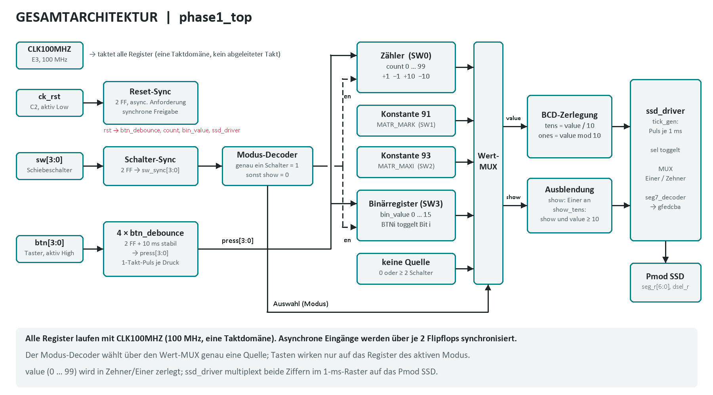

## 01 Einleitung, Ziel und Anforderungen

Die erste Laborphase verbindet eine VHDL-Beschreibung mit einer sichtbaren Ausgabe am Digilent Arty A7-35T. Laut Aufgabenstellung (Folie 210) sind die Ansteuerung der 7-Segment-Anzeige, eine VHDL-Implementierung mit Testbench sowie die Ausgabe der Zahl „0“ über das Arty-Board und ein Pmod mit zwei 7-Segment-Einheiten gefordert. Folie 211 legt den Umfang von Präsentation und Bericht fest: Theorie (Motivation, Arty + Pmod, 7-Segment-Anzeige inklusive Pinbelegung), Entwurf (Blockschaltbild), Implementierung (VHDL, Testbench, Constraints) und Test (Simulation und Board).

Unsere Umsetzung erfüllt die Pflicht – nach dem Reset zeigt der Modus SW0 die Zahl 0 – und erweitert sie zu einem Mehrmodus-Design. Vier Schiebeschalter wählen die Betriebsart, vier Taster verändern den angezeigten Wert. Damit werden alle Grundlagen der Phase I (Segmentcodierung, Zeitmultiplex zweier Ziffern, Pinzuordnung) und zusätzlich die sichere Verarbeitung asynchroner Eingänge (Synchronisation, Entprellung, Flankenauswertung) an einem überschaubaren Beispiel demonstriert.

Der Bericht beschreibt den implementierten Stand exakt. Die RTL-Simulation wurde mit GHDL 6.0.0 durchgeführt und bestanden; zusätzlich wurden alle synthetisierbaren Quellen mit GHDL im Modus VHDL-93 analysiert und synthetisiert. Ein Vivado-Build mit Timing-Analyse und der physische Boardtest sind noch offen und als Prüfliste in Kapitel 15 aufgeführt.

| ID | Anforderung | Umsetzung | Nachweis |
| --- | --- | --- | --- |
| P1-01 | Ausgabe der Zahl 0 | SW0 nach Reset: rechts 0, links dunkel | TB „start“ |
| P1-02 | SW0: BTN0 addiert 1 | press(0) → count + 1 | TB: +1 über 0 … 99 |
| P1-03 | SW0: BTN1 subtrahiert 1, nie < 0 | bei count = 0 bleibt 0 | TB „0 − 1 clamps“ |
| P1-04 | SW0: BTN2 addiert 10 | count + 10; ≥ 90 → 0 | TB „95 + 10 overflow“ |
| P1-05 | SW0: BTN3 subtrahiert 10, nie < 0 | count < 10 → 0 | TB „9 − 10 clamps“ |
| P1-06 | 99 + 1 ergibt 0 | Überlauf auf 0 | TB: +1-Durchlauf |
| P1-07 | SW1: Anzeige 91 (Mark) | Konstante MATR_MARK | TB „SW1 Mark“ |
| P1-08 | SW2: Anzeige 93 (Maxi) | Konstante MATR_MAXI | TB „SW2 Maxi“ |
| P1-09 | SW3: Zahl binär über Taster | BTNi toggelt Bit i (0 … 15) | TB: alle 16 Werte |
| P1-10 | Mehrere Schalter: Anzeige dunkel | show = 0 (auch bei 0 Schaltern) | TB: 5 Kombinationen |
| P1-11 | Ein Druck = genau ein Schritt | btn_debounce, 10 ms | TB Prellen/Halten |
| P1-12 | Reset über ck_rst | count = bin_value = 0 | TB „reset“ |
| P1-13 | Eigenständiges Vivado-Projekt | Tcl-Skript + XDC | Build offen |

## 02 Hardware: Arty A7-35T und Pmod SSD

Zielplattform ist das Arty A7-35T mit dem FPGA xc7a35ticsg324-1L (Artix-7) und einem 100-MHz-Oszillator an Pin E3. Auf dem Board werden die Schiebeschalter SW0 … SW3, die Taster BTN0 … BTN3 und der rote RESET-Taster (ck_rst) verwendet. Die Taster liefern gedrückt eine logische 1 (aktiv High), ck_rst liefert gedrückt eine 0 (aktiv Low). Ein Schiebeschalter in Stellung „oben/ON“ liefert 1. Alle Signale nutzen den IO-Standard LVCMOS33.

Die Anzeige ist das externe Digilent Pmod SSD: zwei 7-Segment-Ziffern mit gemeinsamer Kathode. Das Modul hat zwei 6-polige Stecker: J1 mit AA … AD und J2 mit AE, AF, AG und C, jeweils plus GND und VCC. Die sieben Segmentleitungen AA … AG sind für beide Ziffern gemeinsam; der Pin C wählt die aktive Ziffer. Damit benötigt die Anzeige nur neun Signalleitungen.

Verdrahtung wie im Weckerprojekt: J1 an die UNTERE Reihe (Pins 7 … 12) von JA, J2 an die UNTERE Reihe von JB. Die obere Reihe (Pins 1 … 6) bleibt frei. Vor dem Umstecken die Versorgung trennen, die Orientierung (GND/VCC) prüfen und nur die 3,3-V-Pmod-Versorgung verwenden.

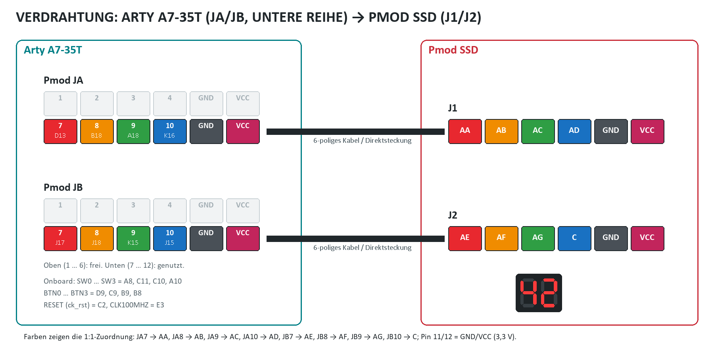

*Abbildung 1: Verdrahtung Arty JA/JB (untere Reihe) zum Pmod SSD J1/J2 mit FPGA-Pins*

| Port | FPGA-Pin | Verbindung | Bedeutung |
| --- | --- | --- | --- |
| CLK100MHZ | E3 | Board-Oszillator | 100 MHz, Periode 10 ns |
| ck_rst | C2 | RESET-Taster (rot) | aktiv Low |
| sw[0] | A8 | SW0 | Modus Zähler |
| sw[1] | C11 | SW1 | Modus 91 (Mark) |
| sw[2] | C10 | SW2 | Modus 93 (Maxi) |
| sw[3] | A10 | SW3 | Modus Binäreingabe |
| btn[0] | D9 | BTN0 | +1 / Bit 0 |
| btn[1] | C9 | BTN1 | −1 / Bit 1 |
| btn[2] | B9 | BTN2 | +10 / Bit 2 |
| btn[3] | B8 | BTN3 | −10 / Bit 3 |
| seg_r[0] | D13 | JA7 → SSD AA | Segment a |
| seg_r[1] | B18 | JA8 → SSD AB | Segment b |
| seg_r[2] | A18 | JA9 → SSD AC | Segment c |
| seg_r[3] | K16 | JA10 → SSD AD | Segment d |
| seg_r[4] | J17 | JB7 → SSD AE | Segment e |
| seg_r[5] | J18 | JB8 → SSD AF | Segment f |
| seg_r[6] | K15 | JB9 → SSD AG | Segment g |
| dsel_r | J15 | JB10 → SSD C | Ziffernauswahl (0: rechts) |

## 03 Funktionsweise der 7-Segment-Anzeige

### 3.1 Aufbau einer Ziffer

Eine Ziffer besteht aus sieben einzeln ansteuerbaren LED-Segmenten, die nach Konvention im Uhrzeigersinn mit a (oben), b (oben rechts), c (unten rechts), d (unten), e (unten links), f (oben links) und g (Mitte) bezeichnet werden. Der Dezimalpunkt wird nicht verwendet. Im VHDL-Vektor seg(6 downto 0) steht Bit 6 für g und Bit 0 für a; als Text geschrieben ergibt sich die Reihenfolge „gfedcba“. Bit i des Ports seg_r ist über den Pmod-Pin A(a+i) mit dem Segment verbunden – zum Beispiel seg_r[0] → AA → Segment a.

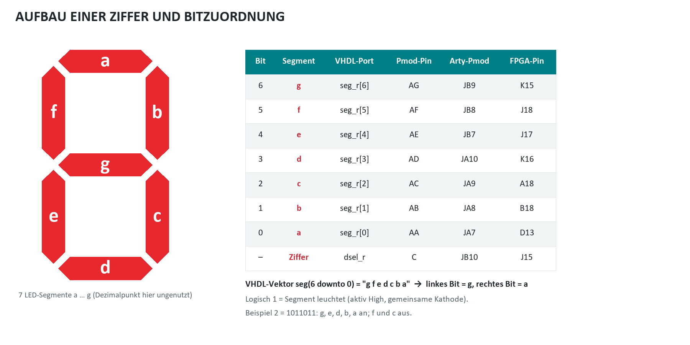

*Abbildung 2: Segmentbezeichnung a … g und Zuordnung Bit → Port → Pmod-Pin → FPGA-Pin*

### 3.2 Elektrisches Prinzip: gemeinsame Kathode

Jedes Segment ist eine Leuchtdiode. Sie leuchtet, wenn ihre Anode positiv gegenüber der Kathode ist und Strom fließt. Bei einer Anzeige mit gemeinsamer Kathode sind die Kathoden aller sieben Segmente einer Ziffer miteinander verbunden. Die Anode jedes Segments wird über eine eigene Leitung angesteuert. Ein Segment leuchtet also genau dann, wenn seine Anodenleitung auf 1 liegt UND die gemeinsame Kathode seiner Ziffer leitend mit GND verbunden ist. Daraus folgt die aktiv-High-Logik: seg_r(i) = 1 schaltet Segment i ein.

Beim Pmod SSD sind die Anodenleitungen gleichnamiger Segmente beider Ziffern verbunden (AA versorgt das a-Segment links und rechts). Der Pin C entscheidet, welche Kathode leitet. Es leuchtet deshalb immer nur eine Ziffer; würden beide Kathoden gleichzeitig leiten, zeigten beide Ziffern dasselbe Muster. Die Zuordnung C = 0 → rechte Ziffer stammt aus dem vorhandenen ssd_driver und wird beim Boardtest bestätigt; bei vertauschten Ziffern genügt es, im Treiber dsel <= not sel zu setzen. Die genaue elektrische Beschaltung (Vorwiderstände, Kathodentreiber) ist dem Digilent-Schaltplan zu entnehmen; für die Logik ist nur die obige Regel relevant.

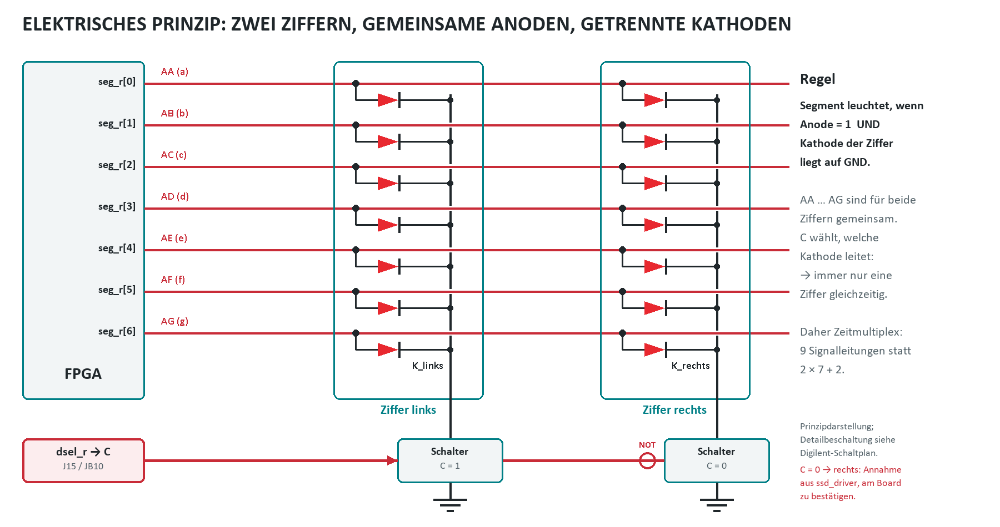

*Abbildung 3: Prinzipschaltung: gemeinsame Anodenleitungen AA … AG, getrennte Kathoden, Auswahl über C*

### 3.3 Segmentcodierung

Der kombinatorische seg7_decoder übersetzt eine 4-Bit-Ziffer (BCD) direkt in das 7-Bit-Muster. Er benötigt keinen Takt; Änderungen am Eingang wirken nach der Gatterlaufzeit. Für die ungültigen BCD-Werte 10 … 15 liefert er einen Mittelstrich (nur g). Diese Werte treten in Phase I nicht auf, weil value immer mit / 10 und mod 10 zerlegt wird.

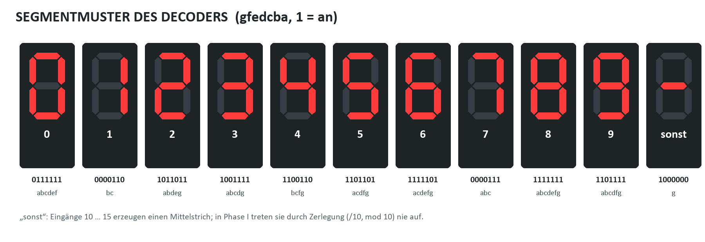

*Abbildung 4: Segmentmuster aller Dezimalziffern und des Ersatzzeichens*

| Ziffer | gfedcba | leuchtende Segmente | Ziffer | gfedcba | leuchtende Segmente |
| --- | --- | --- | --- | --- | --- |
| 0 | 0111111 | a, b, c, d, e, f | 5 | 1101101 | a, c, d, f, g |
| 1 | 0000110 | b, c | 6 | 1111101 | a, c, d, e, f, g |
| 2 | 1011011 | a, b, d, e, g | 7 | 0000111 | a, b, c |
| 3 | 1001111 | a, b, c, d, g | 8 | 1111111 | a, b, c, d, e, f, g |
| 4 | 1100110 | b, c, f, g | 9 | 1101111 | a, b, c, d, f, g |

### 3.4 Zeitmultiplex zweier Ziffern

Weil die Segmentleitungen gemeinsam sind, wird zwischen den Ziffern zeitlich umgeschaltet: Im ersten Zeitschlitz liegt das Muster der Einerstelle an und C wählt die rechte Ziffer; im zweiten Zeitschlitz das Muster der Zehnerstelle mit C für die linke Ziffer. Segmentmuster und Auswahl wechseln in derselben Taktflanke, damit kein Muster kurzzeitig auf der falschen Ziffer erscheint.

Den Takt für das Umschalten liefert tick_gen mit DIV = max(1, CLK_HZ / (2 · REFRESH_HZ)) = 100.000.000 / 1.000 = 100.000. Alle 100.000 Systemtakte (1 ms) entsteht ein 1-Takt-Puls, der das sel-Register invertiert. Ein vollständiges Bild aus beiden Ziffern dauert 2 ms; jede Ziffer wird also 500-mal pro Sekunde mit 50 % Tastverhältnis angesteuert. Das liegt weit über der Flimmergrenze des Auges (je nach Helligkeit und Blickwinkel etwa 50 … 100 Hz), daher erscheinen beide Ziffern gleichzeitig und ruhig.

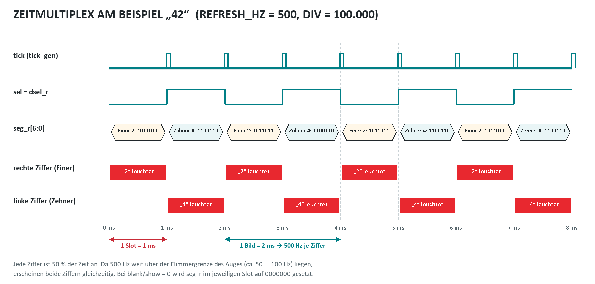

*Abbildung 5: Zeitverlauf des Multiplex für den Wert 42: Puls, Auswahl, Segmentmuster, leuchtende Ziffer*

| Größe | Formel | Wert |
| --- | --- | --- |
| Systemtakt | f_clk | 100 MHz, T = 10 ns |
| Teiler tick_gen | CLK_HZ / (2 · REFRESH_HZ) | 100.000 |
| Zeitschlitz je Ziffer | DIV · 10 ns | 1 ms |
| Vollbild (beide Ziffern) | 2 · Zeitschlitz | 2 ms |
| Wiederholrate je Ziffer | 1 / 2 ms | 500 Hz |
| Tastverhältnis je Ziffer | 1 Slot von 2 | 50 % |

### 3.5 Ausblendung und führende Null

Eine Ziffer wird dunkel, indem in ihrem Zeitschlitz alle Segmentleitungen auf 0 gesetzt werden; C schaltet unverändert weiter. Das Top-Level nutzt dafür zwei Freigaben: show (gültige Betriebsart, gilt für die Einerstelle) und show_tens (show UND value ≥ 10, gilt für die Zehnerstelle). Werte von 0 bis 9 erscheinen dadurch einstellig ohne führende Null, und bei ungültiger Schalterstellung bleibt die gesamte Anzeige dunkel.

## 04 Bedienkonzept und Betriebsarten

Die Betriebsart wird ausschließlich über die vier Schiebeschalter gewählt. Gültig ist nur eine Stellung, in der genau ein Schalter auf 1 steht (one-hot). Jede andere Stellung – kein Schalter oder mehrere Schalter – ergibt eine dunkle Anzeige. Die Taster wirken nur in den Betriebsarten SW0 und SW3; in allen anderen Stellungen werden ihre Pulse ignoriert.

| sw (SW3 … SW0) | Betriebsart | Anzeige | Wirkung der Taster |
| --- | --- | --- | --- |
| 0001 | SW0: Zähler | count, 0 … 99 | BTN0 +1, BTN1 −1, BTN2 +10, BTN3 −10 |
| 0010 | SW1: Matrikelnummer Mark | 91 | keine |
| 0100 | SW2: Matrikelnummer Maxi | 93 | keine |
| 1000 | SW3: Binäreingabe | bin_value, 0 … 15 | BTNi invertiert Bit i |
| 0000 | keine Auswahl | dunkel | keine |
| alle übrigen 11 | mehrere Schalter | dunkel | keine |

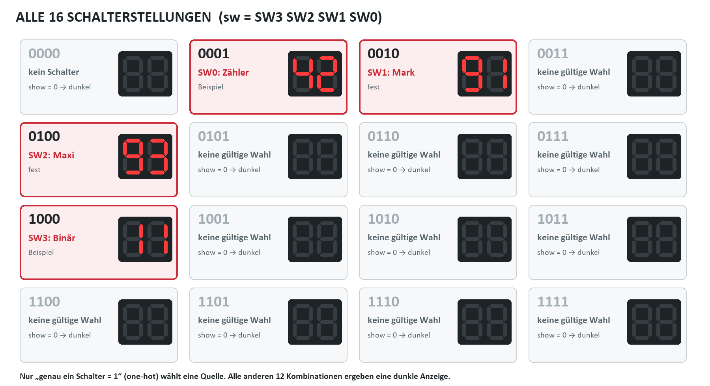

*Abbildung 6: Alle 16 Schalterstellungen mit resultierender Anzeige*

Getroffene Entwurfsentscheidungen, die über die mündliche Aufgabenbeschreibung hinausgehen und deshalb explizit festgelegt wurden:

- Zähler und Binärwert sind getrennte Register. Beide behalten ihren Wert, solange ein anderer Modus aktiv ist, und erscheinen beim Zurückschalten wieder. Nur ck_rst setzt beide auf 0.
- Untere Grenze: −1 bei 0 und −10 bei Werten kleiner 10 ergeben 0 (Sättigung). Negative Zahlen entstehen nie.
- Obere Grenze: Jedes Ergebnis über 99 ergibt 0 – also 99 + 1 → 0 und ebenso 95 + 10 → 0 („zurück auf 0“).
- Binäreingabe als Toggle: Jeder Druck auf BTNi invertiert Bit i. So lässt sich jede Zahl 0 … 15 einstellen, ohne Taster gleichzeitig halten zu müssen. Die Anzeige erfolgt dezimal.
- Führende Null wird in allen Modi unterdrückt (0 … 9 einstellig).
- Gleichzeitige Pulse im Zählermodus werden priorisiert: BTN0 > BTN1 > BTN2 > BTN3. Im Binärmodus werden gleichzeitige Pulse alle übernommen (XOR).
- Beim mechanischen Umschalten können für Mikrosekunden Zwischenstellungen (z. B. 0000 oder 0011) auftreten. Die Anzeige ist dann kurz dunkel; Registerwerte ändern sich dadurch nicht, weil ohne Tastendruck keine Pulse entstehen.

## 05 Gesamtarchitektur

Das Design besitzt genau eine Taktdomäne: Alle Register werden mit CLK100MHZ getaktet. Langsame Vorgänge (1-ms-Multiplex, 10-ms-Entprellung) werden über Zähler und 1-Takt-Freigabepulse realisiert, nicht über abgeleitete Takte. Das vermeidet Taktversatz und vereinfacht die Timing-Analyse.

Der Datenfluss verläuft von links nach rechts: Die asynchronen Eingänge werden synchronisiert (Reset, Schalter) bzw. synchronisiert und entprellt (Taster). Der Modus-Decoder bestimmt aus sw_sync, welche Quelle der Wert-MUX auf value legt und ob die Anzeige freigegeben ist (show). Die Register count und bin_value reagieren nur auf press-Pulse, wenn ihr Modus aktiv ist (Freigabe en). value wird in Zehner und Einer zerlegt und vom ssd_driver im Zeitmultiplex ausgegeben; die Ausblendung blendet ungültige oder führende Stellen aus.


*Abbildung 7: Gesamtblockschaltbild von phase1_top*

Die Modulhierarchie ist flach: phase1_top instanziiert viermal btn_debounce (for-generate) und einmal ssd_driver, der wiederum tick_gen und seg7_decoder enthält. Die übrige Logik ist in vier Prozessen und wenigen nebenläufigen Zuweisungen im Top-Level beschrieben.

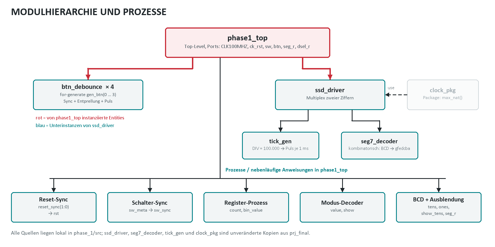

*Abbildung 8: Modulhierarchie und Prozesse*

| Signal | Typ / Bereich | Bedeutung |
| --- | --- | --- |
| rst | std_logic | synchron freigegebener Reset (reset_sync(1)) |
| sw_sync | std_logic_vector(3 downto 0) | synchronisierte Schalter |
| press | std_logic_vector(3 downto 0) | 1-Takt-Puls je akzeptiertem Tastendruck |
| count | natural range 0 to 99 | Zählerstand (SW0) |
| bin_value | unsigned(3 downto 0) | Binärwert (SW3) |
| value | natural range 0 to 99 | anzuzeigender Wert der aktiven Quelle |
| show / show_tens | std_logic | Freigabe Einer- bzw. Zehnerstelle |
| tens / ones | unsigned(3 downto 0) | BCD-Ziffern für ssd_driver |
| driver_seg / driver_sel | std_logic_vector / std_logic | Ausgang des ssd_driver vor der Ausblendung |

## 06 Eingangsstufe: Reset, Schalter, Entprellung

### 6.1 Reset: asynchron anfordern, synchron freigeben

ck_rst (aktiv Low) setzt die zweistufige Kette reset_sync asynchron auf „11“. Nach dem Loslassen werden mit den nächsten zwei steigenden Flanken Nullen nachgeschoben; rst = reset_sync(1) fällt also synchron zum Takt. So kann das Lösen des Resets keine Setup-/Hold-Verletzung in den nachfolgenden Registern verursachen. rst setzt btn_debounce, count, bin_value und den ssd_driver zurück.

### 6.2 Synchronisation der Schalter

Die Schalter sind zum Systemtakt asynchron. Zwei hintereinander geschaltete Flipflops (sw_meta → sw_sync) reduzieren die Wahrscheinlichkeit, dass ein metastabiler Zustand die Modus-Logik erreicht, auf ein vernachlässigbares Maß. Eine Entprellung der Schalter ist nicht nötig: Prellen beim Umschalten führt nur zu einer kurzen Zwischenanzeige, nicht zu Registeränderungen.

```vhdl
process (CLK100MHZ, ck_rst)
begin
    if ck_rst = '0' then
        reset_sync <= (others => '1');
    elsif rising_edge(CLK100MHZ) then
        reset_sync <= reset_sync(0) & '0';
    end if;
end process;

rst <= reset_sync(1);

process (CLK100MHZ)
begin
    if rising_edge(CLK100MHZ) then
        sw_meta <= sw;
        sw_sync <= sw_meta;
```

### 6.3 Entprellung der Taster (btn_debounce)

Mechanische Taster prellen beim Drücken und Loslassen für einige Millisekunden. Ohne Entprellung würde ein einzelner Druck mehrere Zählschritte auslösen. btn_debounce synchronisiert den Taster zunächst mit zwei Flipflops und vergleicht dann sync(1) mit dem zuletzt akzeptierten Zustand stable. Weicht der Eingang ab, zählt cnt hoch; kehrt er zum alten Zustand zurück, beginnt cnt wieder bei 0. Erst wenn der Eingang DEBOUNCE_CYCLES = 1.000.000 Takte (10 ms) ununterbrochen abweicht, wird stable übernommen.

Bei der Übernahme wird press für genau einen Takt auf den neuen Pegel gesetzt. Nur der Übergang 0 → 1 erzeugt also einen Puls; Halten erzeugt keine weiteren Pulse (kein Auto-Repeat), Loslassen erzeugt keinen Puls. Die Latenz von der letzten Prellflanke bis zum Puls beträgt 10 ms plus drei Systemtakte.

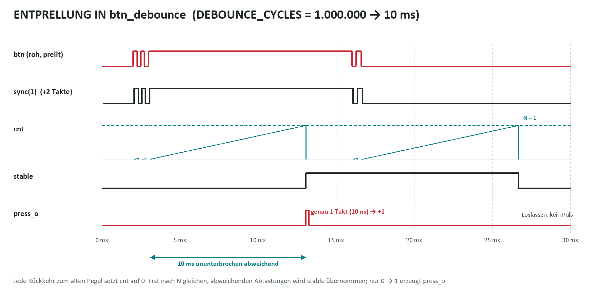

*Abbildung 9: Zeitverlauf der Entprellung: roher Taster, synchronisiert, Zähler, stabiler Zustand, Puls*

```vhdl
        if rst = '1' then
            sync   <= (others => '0');
            stable <= '0';
            cnt    <= 0;
        else
            sync <= sync(0) & btn_i;
            if sync(1) = stable then
                cnt <= 0;
            elsif cnt = DEBOUNCE_CYCLES - 1 then
                cnt    <= 0;
                stable <= sync(1);
                -- nur die akzeptierte Low->High-Flanke erzeugt einen Puls
                press  <= sync(1);
            else
                cnt <= cnt + 1;
            end if;
        end if;
    end if;
end process;

press_o <= press;
```

| Parameter / Zustand | Wert / Wirkung |
| --- | --- |
| DEBOUNCE_CYCLES | 1.000.000 Takte = 10 ms (Simulation: 4) |
| Synchronisation | 2 FF, + 20 ns Latenz |
| stable 0 → 1 | press = 1 für einen Takt (10 ns) |
| stable bleibt 1 (Halten) | keine weiteren Pulse |
| stable 1 → 0 (Loslassen) | kein Puls, nur Freigabe für den nächsten Druck |
| Instanzen | 4 (gen_btn: BTN0 … BTN3) |

## 07 Betriebsart SW0: Zähler 0 … 99

Ist nur SW0 eingeschaltet, legt der Modus-Decoder count auf value und gibt die Anzeige frei. Die vier Taster verändern count; der rote Pfad im folgenden Bild zeigt alle in diesem Modus aktiven Blöcke. Nach dem Reset ist count = 0 – damit ist die geforderte Ausgabe der Zahl „0“ erfüllt.

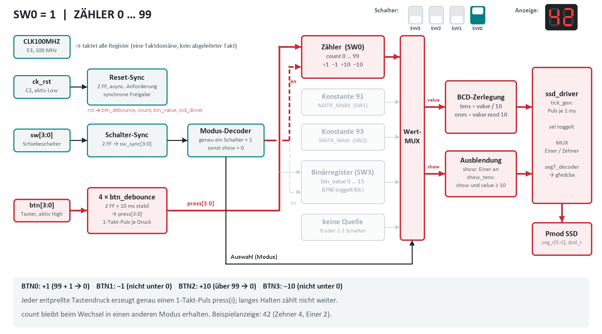

*Abbildung 10: Aktiver Datenpfad in Betriebsart SW0*

Pro Taktflanke wird höchstens eine Änderung ausgeführt. Die if/elsif-Kette prüft die Pulse in der Reihenfolge BTN0, BTN1, BTN2, BTN3. Vor jeder Rechnung wird die Grenze geprüft, sodass count den Bereich 0 … 99 nie verlässt – auch nicht kurzzeitig. Das ist wichtig, weil count als natural range 0 to 99 deklariert ist; ein Wert außerhalb wäre in der Simulation ein Laufzeitfehler.

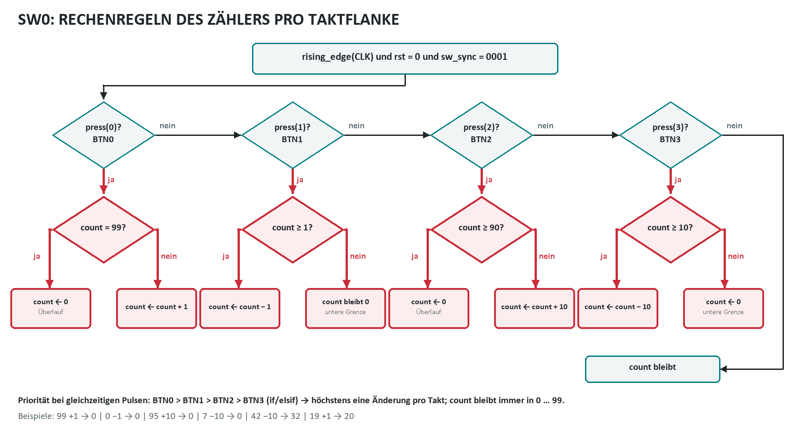

*Abbildung 11: Entscheidungslogik des Zählers je Taktflanke*

| Ausgangswert | Taste | Ergebnis | Regel |
| --- | --- | --- | --- |
| 0 | BTN0 (+1) | 1 | normal |
| 99 | BTN0 (+1) | 0 | Überlauf → 0 |
| 0 | BTN1 (−1) | 0 | untere Grenze |
| 20 | BTN1 (−1) | 19 | normal |
| 42 | BTN2 (+10) | 52 | normal |
| 95 | BTN2 (+10) | 0 | Ergebnis > 99 → 0 |
| 42 | BTN3 (−10) | 32 | normal |
| 7 | BTN3 (−10) | 0 | untere Grenze |

```vhdl
elsif sw_sync = MODE_COUNT then
    if press(0) = '1' then
        if count = 99 then
            count <= 0;
        else
            count <= count + 1;
        end if;
    elsif press(1) = '1' then
        if count >= 1 then
            count <= count - 1;
        end if;
    elsif press(2) = '1' then
        if count >= 90 then
            count <= 0;
        else
            count <= count + 10;
        end if;
    elsif press(3) = '1' then
        if count >= 10 then
            count <= count - 10;
        else
            count <= 0;
        end if;
    end if;
elsif sw_sync = MODE_BINARY then
    bin_value <= bin_value xor unsigned(press);
```

## 08 Betriebsarten SW1 und SW2: Matrikelnummern

In den Betriebsarten SW1 und SW2 zeigt die Anzeige eine feste Zahl: die Endziffern der Matrikelnummern der Gruppenmitglieder, 91 für Mark und 93 für Maxi. Die Werte sind als Konstanten MATR_MARK und MATR_MAXI im Top-Level hinterlegt und können dort zentral geändert werden. Es gibt kein Register – der Wert-MUX legt die Konstante direkt auf value. Die Taster haben keine Wirkung; count und bin_value bleiben unverändert erhalten.

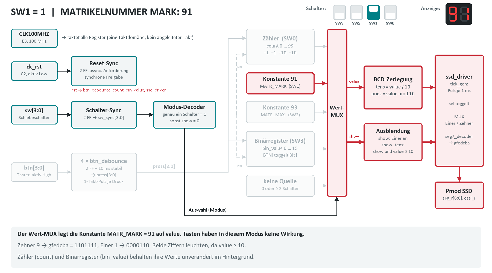

*Abbildung 12: Aktiver Datenpfad in Betriebsart SW1 (91)*

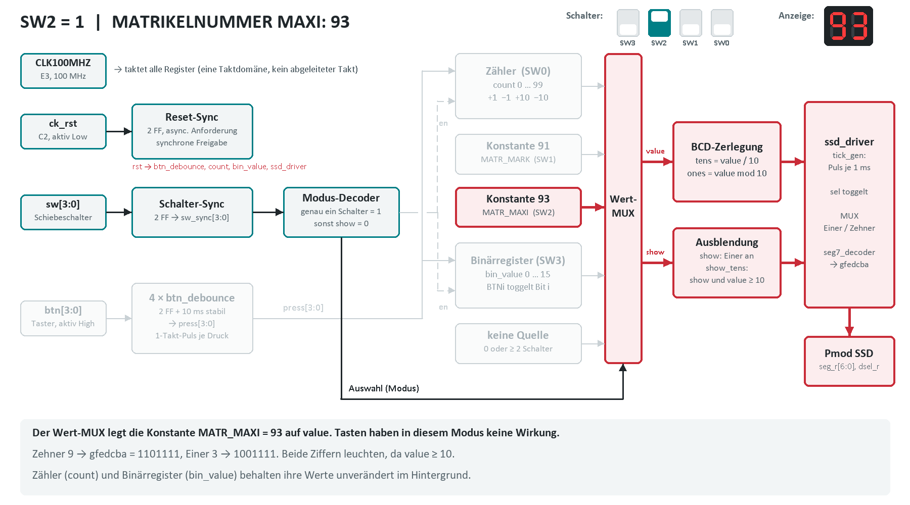

*Abbildung 13: Aktiver Datenpfad in Betriebsart SW2 (93)*

| Modus | value | Zehner (links) | Muster | Einer (rechts) | Muster |
| --- | --- | --- | --- | --- | --- |
| SW1 | 91 | 9 | 1101111 | 1 | 0000110 |
| SW2 | 93 | 9 | 1101111 | 3 | 1001111 |

Da beide Werte ≥ 10 sind, ist show_tens = 1 und beide Ziffern leuchten. Die Zehnerziffer 9 ist in beiden Modi identisch; der Unterschied ist nur an der rechten Ziffer sichtbar – ein guter Test für die korrekte Zuordnung der Segmente b, c und d.

## 09 Betriebsart SW3: Binäreingabe

In der Betriebsart SW3 wird eine Zahl binär über die vier Taster eingegeben. Jeder Taster ist einem Bit von bin_value fest zugeordnet: BTN0 → Bit 0 (Wertigkeit 1), BTN1 → Bit 1 (2), BTN2 → Bit 2 (4), BTN3 → Bit 3 (8). Jeder entprellte Druck invertiert das zugehörige Bit (Toggle-Flipflop). Der einstellbare Bereich ist 0 … 15; angezeigt wird der Wert dezimal.

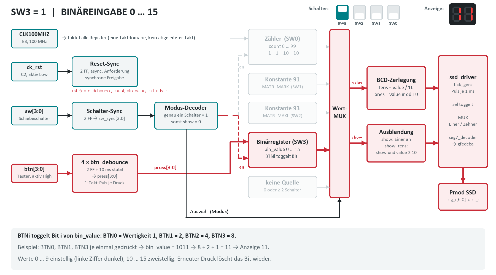

*Abbildung 14: Aktiver Datenpfad in Betriebsart SW3*

In VHDL ist das eine einzige Zeile: bin_value <= bin_value xor unsigned(press). Da press nur für einen Takt 1 ist, wird jedes Bit pro Druck genau einmal invertiert. Gleichzeitige Pulse mehrerer Taster werden alle übernommen.

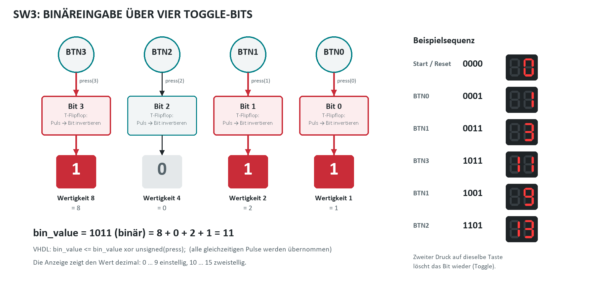

*Abbildung 15: Toggle-Bits mit Wertigkeiten und Beispielsequenz*

| Aktion | bin_value | Rechnung | Anzeige |
| --- | --- | --- | --- |
| Reset | 0000 | 0 | 0 |
| BTN0 | 0001 | 1 | 1 |
| BTN1 | 0011 | 2 + 1 | 3 |
| BTN3 | 1011 | 8 + 2 + 1 | 11 |
| BTN1 | 1001 | 8 + 1 | 9 |
| BTN2 | 1101 | 8 + 4 + 1 | 13 |

## 10 Ungültige Schalterstellungen

Steht kein Schalter oder stehen mehrere Schalter auf 1, gibt es keine eindeutige Quelle. Der Modus-Decoder setzt dann show = 0 (der when-others-Zweig der case-Anweisung). Die Ausblendung setzt seg_r in beiden Zeitschlitzen auf 0000000; ssd_driver und dsel_r laufen unverändert weiter. Tastendrücke werden ignoriert, weil weder count noch bin_value freigegeben sind.

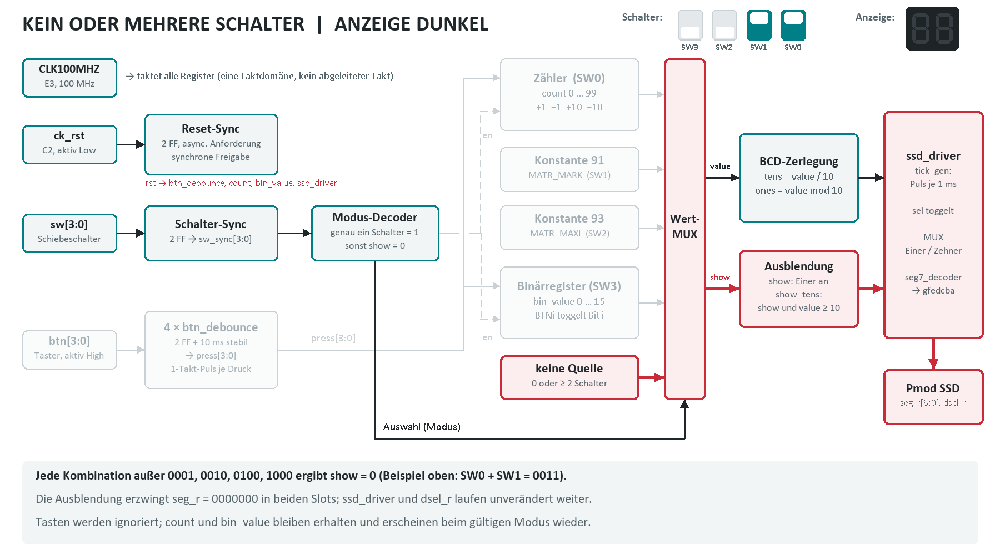

*Abbildung 16: Datenpfad bei ungültiger Schalterstellung (Beispiel 0011)*

Die Entscheidung über alle 16 Stellungen trifft eine einzige case-Anweisung. Weil die Freigaben aus demselben Vergleich entstehen, können Wert-MUX und Ausblendung nie widersprüchlich sein:

```vhdl
process (sw_sync, count, bin_value)
begin
    value <= 0;
    show  <= '0';
    case sw_sync is
        when MODE_COUNT  => value <= count;                  show <= '1';
        when MODE_MARK   => value <= MATR_MARK;              show <= '1';
        when MODE_MAXI   => value <= MATR_MAXI;              show <= '1';
        when MODE_BINARY => value <= to_integer(bin_value);  show <= '1';
        when others      => null;
    end case;
end process;
```

## 11 Anzeigepfad im Detail

Der Anzeigepfad ist für alle Betriebsarten identisch. value (0 … 99) wird kombinatorisch zerlegt: tens = value / 10 und ones = value mod 10. Die Division durch die Konstante 10 erzeugt die Synthese als kleine Logikfunktion (7 Eingangsbits); es entsteht weder ein Divisionsrechenwerk noch ein zusätzlicher Takt. Beide Ziffern gehen an den unveränderten ssd_driver aus dem Weckerprojekt.

Im ssd_driver erzeugt tick_gen alle 1 ms einen Puls; das sel-Register wechselt bei jedem Puls. sel steuert den Ziffern-MUX (0: ones, 1: tens) und wird gleichzeitig als dsel_r an Pin C ausgegeben. Der seg7_decoder erzeugt aus der gewählten Ziffer das Muster. Im Top-Level entscheidet die Ausblendung anhand von sel, ob das Muster durchgeschaltet wird: im Einer-Slot bei show = 1, im Zehner-Slot bei show_tens = 1.

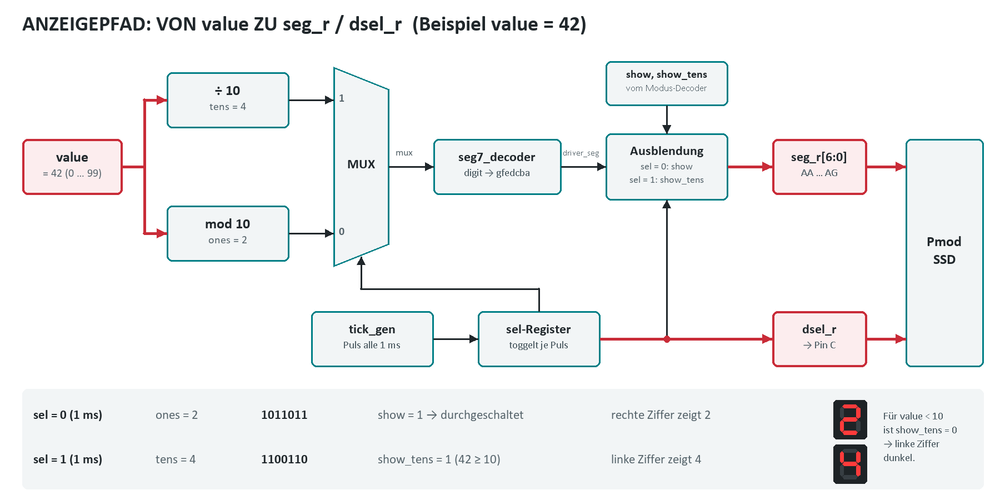

*Abbildung 17: Anzeigepfad von value bis zu den Pmod-Pins, mit beiden Zeitschlitzen für 42*

```vhdl
tens <= to_unsigned(value / 10, 4);
ones <= to_unsigned(value mod 10, 4);

-- fuehrende Null wird unterdrueckt
show_tens <= '1' when show = '1' and value >= 10 else '0';

display : entity work.ssd_driver
    generic map (CLK_HZ => CLK_HZ, REFRESH_HZ => REFRESH_HZ)
    port map (
        clk    => CLK100MHZ,
        rst    => rst,
        digit0 => ones,
        digit1 => tens,
        seg    => driver_seg,
        dsel   => driver_sel
    );

seg_r <= driver_seg when (driver_sel = '0' and show = '1') or (driver_sel = '1' and show_tens = '1')
         else (others => '0');
dsel_r <= driver_sel;
```

## 12 VHDL-Implementierung und Dateien

Alle Quellen liegen lokal im Ordner phase_1/src; das Projekt hat keine Verweise auf andere Ordner. Neu bzw. geändert sind phase1_top.vhd und btn_debounce.vhd. ssd_driver, seg7_decoder, tick_gen und clock_pkg sind unveränderte Kopien aus prj_final.

| Datei | Inhalt | Status |
| --- | --- | --- |
| src/phase1_top.vhd | Top-Level: Reset/Schalter-Sync, Register, Modus-Decoder, BCD, Ausblendung | neu |
| src/btn_debounce.vhd | Synchronisation, Entprellung, 1-Takt-Puls | neu |
| src/ssd_driver.vhd | Multiplex zweier Ziffern | unverändert |
| src/seg7_decoder.vhd | BCD → gfedcba | unverändert |
| src/tick_gen.vhd | generischer Pulsgeber | unverändert |
| src/clock_pkg.vhd | Hilfsfunktion max_nat | unverändert |
| sim/tb_phase1_top.vhd | selbstprüfende Testbench | neu |
| constraints/arty_a7_35_ssd.xdc | Pins, IO-Standard, Takt | erweitert um sw, btn |

Die Generics CLK_HZ, DEBOUNCE_CYCLES und REFRESH_HZ trennen die Logik von den Zeitkonstanten. Auf dem Board gelten die Standardwerte (100 MHz, 10 ms, 500 Hz); die Testbench setzt kleinere Werte, um alle Funktionen in kurzer Simulationszeit zu prüfen.

Der synthetisierbare Code verwendet ausschließlich VHDL-93-Sprachmittel (keine bedingten Zuweisungen in Prozessen, keine Ausdrücke in Port-Maps). Eine Analyse und Synthese aller Quellen mit GHDL im Modus --std=93c lief fehlerfrei. Das Vivado-Projekt wird trotzdem als VHDL-2008 angelegt, weil die Testbench std.env.finish verwendet.

## 13 Pin-Constraints und Vivado-Ablauf

constraints/arty_a7_35_ssd.xdc ordnet alle Ports den FPGA-Pins zu, setzt LVCMOS33 und beschreibt den 100-MHz-Takt (create_clock, Periode 10 ns). Gegenüber der vorherigen Version sind die Schalter sw[3:0] und die Taster btn[3:0] hinzugekommen; der frühere Einzeltaster btn_up entfällt. Die Pins stammen aus dem Digilent-Master-XDC bzw. dem Weckerprojekt.

```vhdl
## SW0: Zaehler | SW1: 91 (Mark) | SW2: 93 (Maxi) | SW3: Binaereingabe
set_property -dict { PACKAGE_PIN A8  IOSTANDARD LVCMOS33 } [get_ports {sw[0]}]
set_property -dict { PACKAGE_PIN C11 IOSTANDARD LVCMOS33 } [get_ports {sw[1]}]
set_property -dict { PACKAGE_PIN C10 IOSTANDARD LVCMOS33 } [get_ports {sw[2]}]
set_property -dict { PACKAGE_PIN A10 IOSTANDARD LVCMOS33 } [get_ports {sw[3]}]
## BTN0: +1 / Bit0 | BTN1: -1 / Bit1 | BTN2: +10 / Bit2 | BTN3: -10 / Bit3
set_property -dict { PACKAGE_PIN D9 IOSTANDARD LVCMOS33 } [get_ports {btn[0]}]
set_property -dict { PACKAGE_PIN C9 IOSTANDARD LVCMOS33 } [get_ports {btn[1]}]
set_property -dict { PACKAGE_PIN B9 IOSTANDARD LVCMOS33 } [get_ports {btn[2]}]
set_property -dict { PACKAGE_PIN B8 IOSTANDARD LVCMOS33 } [get_ports {btn[3]}]
```

Projektanlage: Im Ordner phase_1 „vivado -mode gui -source scripts/create_project.tcl“ ausführen oder im Vivado-Tcl-Terminal „source scripts/create_project.tcl“. Das Skript legt das Projekt unter vivado/ an, fügt alle Quellen, die Testbench und die Constraints hinzu und setzt phase1_top bzw. tb_phase1_top als Top-Level. Danach: Behavioral Simulation, Synthesis, Implementation, Report Timing Summary / DRC, Generate Bitstream, Hardware Manager.

| Prüfpunkt | Akzeptanzkriterium |
| --- | --- |
| Top-Level | phase1_top / tb_phase1_top |
| Part | xc7a35ticsg324-1L |
| Ports | alle 18 Ports zugeordnet, keine unconstrained-IO-Warnung |
| Timing | 10-ns-Takt, WNS und WHS ≥ 0 |
| Bitstream | erzeugt und auf das Board geladen |

## 14 Simulation und Testergebnisse

tb_phase1_top ist selbstprüfend: Assertions vergleichen die externen Ausgänge seg_r und dsel_r mit unabhängig in der Testbench hinterlegten Mustern. Die Prozedur expect_number(n) beobachtet jeweils 24 Takte, prüft in jedem Takt das Muster des gerade aktiven Zeitschlitzes (rechts: Einer, links: Zehner oder dunkel) und verlangt, dass beide Zeitschlitze tatsächlich beobachtet wurden. Verglichen wird an der fallenden Flanke, nachdem Register und Kombinatorik eingeschwungen sind.

Simulationsparameter: CLK_HZ = 100, DEBOUNCE_CYCLES = 4, REFRESH_HZ = 10 (Zeitschlitz = 5 Takte). Ein Tastendruck dauert in der Testbench 10 Takte gedrückt und 10 Takte losgelassen. Die Logik ist identisch zur Hardware, nur die Zeitkonstanten sind verkleinert. Die Simulation prüft nicht das elektrische Prellen eines realen Tasters und keine analogen Eigenschaften der LEDs.

| Test | Stimulus | Erwartung |
| --- | --- | --- |
| Kein Schalter | sw = 0000 nach Reset | beide Ziffern dunkel |
| Startwert | sw = 0001 | rechts 0, links dunkel |
| Untere Grenze | BTN1, BTN3 bei 0; BTN3 bei 9 | 0 |
| Prellen | 1-Takt-Pulse auf BTN0 | kein Schritt |
| Halten / Loslassen | BTN0 über 150 Takte gedrückt | genau +1 |
| Voller Durchlauf | 99 × BTN0 ab 1 | jeder Wert 2 … 99 und 99 → 0 korrekt |
| ±10 | BTN2/BTN3/BTN1 gemischt | 10, 20, 19, 9, 0 |
| Überlauf +10 | 95 + BTN2 | 0 |
| SW1 / SW2 | sw = 0010 / 0100, Taster drücken | 91 / 93, Taster ohne Wirkung |
| Wert erhalten | zurück auf SW0 | 42 unverändert |
| SW3 | alle Werte 0 … 15 per Toggle | jeder Wert korrekt, dann 15 → 7 |
| Mehrere Schalter | 0011, 0101, 1100, 1111 | dunkel, Taster ignoriert |
| Reset | ck_rst = 0 | count = bin_value = 0 |

Ergebnis mit GHDL 6.0.0: „PASS: phase 1 modes SW0 counter (+1/-1/+10/-10, clamp 0, 99->0), SW1 91, SW2 93, SW3 binary, invalid switches blank, bounce, hold, reset“ nach 69.050 ns Simulationszeit, ohne Assertion-Fehler. Das Protokoll liegt in sim/testergebnis.txt, die Wellenform in sim/build/simulation.ghw. Aufruf aus dem Ordner phase_1: ./scripts/run_sim.ps1 -Ghdl <Pfad zu ghdl.exe>.

## 15 Boardabnahme, Fazit und Quellen

Die logischen Anforderungen sind in der RTL-Simulation nachgewiesen. Offen sind Synthese, Implementation und Timing-Analyse in Vivado sowie der Boardtest. Die folgende Prüfliste ist ein Abnahmeplan; Datum, Vivado-Version und Beobachtungen werden beim Test eingetragen.

- [ ] Verdrahtung bei ausgeschalteter Versorgung geprüft (JA/JB untere Reihe, GND/VCC)
- [ ] Alle Schalter aus: Anzeige dunkel
- [ ] SW0: rechts 0, links dunkel; BTN0 zählt pro Druck genau einmal, Halten zählt nicht weiter
- [ ] SW0: BTN1/BTN3 bei 0 bleiben 0; 99 + 1 → 0; 95 + 10 → 0; 9 → 10 zeigt beide Ziffern
- [ ] Linke/rechte Ziffer richtig zugeordnet (sonst dsel invertieren)
- [ ] SW1 zeigt 91, SW2 zeigt 93
- [ ] SW3: BTN0, BTN1, BTN3 → 11; erneuter Druck löscht das Bit
- [ ] Zwei Schalter gleichzeitig: dunkel; nach Rückkehr zu SW0 ist der alte Zählerstand da
- [ ] RESET setzt Zähler und Binärwert auf 0
- [ ] kein sichtbares Flackern oder Ghosting; Timing-Bericht ohne Verletzungen

Fazit: Das Design trennt Eingabeverarbeitung (Synchronisation, Entprellung), Zustandslogik (Zähler, Binärregister, Modus-Decoder) und Anzeige (BCD-Zerlegung, Multiplex, Decoder). Jede Schicht ist einzeln verständlich und testbar. Der Anzeigepfad wird in Phase II unverändert für den Sekundenzähler weiterverwendet; dort ändert sich nur die Quelle von value.

Aufgabenstellung: Laborfolien „Labor: 7-Segment-Anzeige“, Phase I (Folien 210/211), phase_1/task/image3.png und image4.png.

Digilent Arty A7 Reference Manual: https://digilent.com/reference/programmable-logic/arty-a7/reference-manual

Digilent Pmod SSD Reference Manual: https://digilent.com/reference/pmod/pmodssd/reference-manual

Digilent Master-XDC: https://github.com/Digilent/digilent-xdc/blob/master/Arty-A7-35-Master.xdc

GHDL-Dokumentation: https://ghdl.github.io/ghdl/

Lokale Referenz: prj_final/src und prj_final/constraints/arty_a7_35_wecker.xdc (Pinbelegung, Anzeigemodule).
