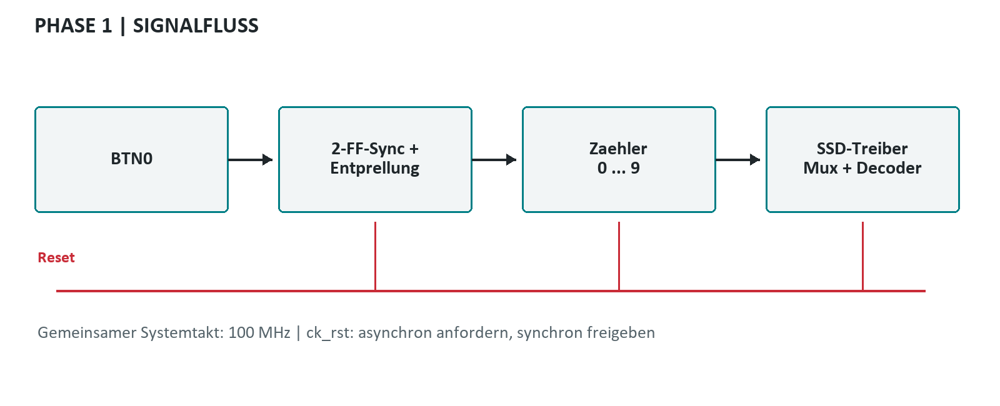

# Phase I - 7-Segment-Anzeige

Autor / Gruppe: noch zu ergaenzen.

Status: RTL-Simulation bestanden; Vivado-Build und physischer Boardtest offen.

## 01 Ziel, Aufgabenstellung und Abgrenzung

Die erste Laborphase verbindet eine VHDL-Beschreibung mit einer sichtbaren Ausgabe am Arty A7-35T. Die Aufgabenbilder fordern die Ansteuerung eines Pmod SSD, eine Testbench und die Ausgabe der Zahl 0. Diese Basis wird hier um einen manuellen Dezimalzaehler erweitert: Jeder gueltige Druck auf BTN0 erhoeht die rechte Ziffer einmal. Nach 9 folgt 0; die linke Ziffer bleibt dunkel.

Die Erweiterung veraendert das Lernziel nicht: Segmentcodierung, Pinzuordnung und zeitliches Verhalten bleiben direkt beobachtbar. Nach Einschalten beziehungsweise Reset steht die rechte Anzeige auf 0. Die zweite Phase nutzt denselben Anzeigepfad fuer einen Sekundenzaehler. Die dritte Phase ist eine getrennte, unveraenderte Kopie des vorhandenen Weckers.

Dieser Bericht dokumentiert den implementierten Stand. Die automatisierte RTL-Simulation wurde mit GHDL 6.0.0 ausgefuehrt. Eine erfolgreiche Synthese, Timing Closure oder eine Messung am physischen Board wird nicht behauptet. Die entsprechenden Abnahmeschritte sind als offene Pruefliste aufgenommen.

| ID | Anforderung | Nachweis |
| --- | --- | --- |
| P1-01 | Startwert 0, links dunkel | Testbench + Boardpruefung offen |
| P1-02 | Ein Inkrement pro Tastendruck | Prell-/Halte-/Loslasstest |
| P1-03 | Dezimaler Umlauf 0 bis 9 | Alle zehn Muster simuliert |
| P1-04 | Reset ueber ck_rst | Reset nach Zaehlschritten simuliert |
| P1-05 | Eigenstaendiges Vivado-Projekt | Tcl + XDC enthalten; Build offen |

## 02 Hardware und sichere Verdrahtung

Verwendet wird der Arty A7-35T mit dem FPGA-Part xc7a35ticsg324-1L und dem 100-MHz-Oszillator. Das externe Digilent Pmod SSD besitzt zwei Ziffern mit gemeinsam genutzten Segmentleitungen. Es handelt sich nicht um eine bereits auf dem Arty integrierte Anzeige. Ein Pmod SSD reicht fuer Phase I und II aus.

Die Verdrahtung entspricht dem bestehenden Weckerprojekt: JA und JB werden jeweils in der UNTEREN Reihe verwendet. Die Segmentanschluesse AA bis AG und der Ziffernselektor C des SSD werden einzeln zugeordnet. Versorgung und gemeinsame Masse sind zusaetzlich erforderlich; die Signaltabelle ersetzt diese Versorgungsanschluesse nicht. Vor dem Umstecken die Versorgung ausschalten, Steckerausrichtung kontrollieren und nur die fuer das Modul vorgesehene 3,3-V-Versorgung verwenden.

Alle Signale verwenden LVCMOS33. BTN0 ist aktiv High, der Reset-Eingang ck_rst aktiv Low. Die Annahme dsel_r=0 fuer die rechte Ziffer stammt aus dem vorhandenen ssd_driver. Die reale Zuordnung wird beim Boardtest mit einer bekannten Ziffer kontrolliert.

| Port / Segment | FPGA-Pin | Verbindung | Bedeutung |
| --- | --- | --- | --- |
| CLK100MHZ | E3 | Board-Oszillator | 100 MHz / 10 ns |
| ck_rst | C2 | RESET-Taster | Aktiv Low |
| btn_up | D9 | BTN0 | Aktiv High; nur Phase 1 |
| seg_r[0] / a | D13 | JA7 -> SSD AA | Aktiv High |
| seg_r[1] / b | B18 | JA8 -> SSD AB | Aktiv High |
| seg_r[2] / c | A18 | JA9 -> SSD AC | Aktiv High |
| seg_r[3] / d | K16 | JA10 -> SSD AD | Aktiv High |
| seg_r[4] / e | J17 | JB7 -> SSD AE | Aktiv High |
| seg_r[5] / f | J18 | JB8 -> SSD AF | Aktiv High |
| seg_r[6] / g | K15 | JB9 -> SSD AG | Aktiv High |
| dsel_r | J15 | JB10 -> SSD C | 0: rechts; 1: links |

## 03 Theorie der 7-Segment-Anzeige

Sieben einzeln ansteuerbare Leuchtsegmente a bis g bilden eine Dezimalziffer. Die gemeinsame Kathode und die Beschaltung des Pmod SSD fuehren zu aktiven High-Signalen: Eine logische 1 schaltet das betreffende Segment ein. Im VHDL-Vektor seg(6 downto 0) steht Bit 6 fuer g und Bit 0 fuer a. Diese Reihenfolge ist bei jeder Fehlersuche zuerst zu kontrollieren.

Der Decoder ist kombinatorisch. Er uebersetzt eine 4-Bit-Ziffer unmittelbar in ein Segmentmuster und benoetigt keinen eigenen Takt. Fuer Werte ausserhalb 0 bis 9 zeigt der uebernommene Decoder einen Mittelstrich; blank=1 schaltet alle Segmente ab. Im normalen Zaehlerbetrieb werden ausschliesslich gueltige Dezimalwerte erzeugt.


| Ziffer | gfedcba | Leuchtende Segmente |
| --- | --- | --- |
| 0 | 0111111 | a, b, c, d, e, f |
| 1 | 0000110 | b, c |
| 2 | 1011011 | a, b, d, e, g |
| 3 | 1001111 | a, b, c, d, g |
| 4 | 1100110 | b, c, f, g |
| 5 | 1101101 | a, c, d, f, g |
| 6 | 1111101 | a, c, d, e, f, g |
| 7 | 0000111 | a, b, c |
| 8 | 1111111 | a, b, c, d, e, f, g |
| 9 | 1101111 | a, b, c, d, f, g |

## 04 Entwurf und Gesamtsystem Phase I + II

In Phase I durchlaeuft BTN0 zuerst zwei Synchronisationsregister und danach eine Stabilitaetspruefung. Nur der akzeptierte Wechsel von Low nach High veraendert den Zaehler. Der Zaehler stellt eine Ziffer bereit; ssd_driver waehlt die aktive Stelle und seg7_decoder erzeugt die Segmentbits. Der linke Multiplex-Slot wird durch Nullsetzen der Ausgaenge ausgeblendet.

Phase II ersetzt den manuellen Ereignispfad durch einen synchronen Sekundenteiler. Ein Zaehler von 0 bis 99 liefert Einer und Zehner an denselben Treiber. Der Systemtakt bleibt in beiden Phasen unveraendert; Zaehlen erfolgt ueber eine Bedingung innerhalb des getakteten Prozesses und nicht ueber einen neu erzeugten langsamen Takt.

Die gemeinsame Resetstruktur setzt die Steuerung und den Anzeigezustand zurueck. Das aktive Low-Eingangssignal fordert Reset asynchron an; zwei Register geben ihn synchron zum Systemtakt frei. Die eigentlichen Zustandsregister reagieren am naechsten Systemtakt. Alle neuen Module sind bewusst klein gehalten, damit der Datenfluss im Labor nachvollzogen werden kann.



| Baustein | Aufgabe |
| --- | --- |
| phase1_top / phase2_top | Eingang, Reset und Zaehlersteuerung |
| ssd_driver | Stellenauswahl und zeitliches Multiplexen |
| seg7_decoder | Dezimalziffer zu gfedcba |
| tick_gen / clock_pkg | Refresh-Enable und Hilfsfunktion max_nat |

## 05 Synchronisation, Entprellung und Reset

Ein mechanischer Taster ist zum FPGA-Takt asynchron. Zwei hintereinander geschaltete Flipflops reduzieren die Wahrscheinlichkeit, dass ein metastabiler Zustand in die nachfolgende Logik gelangt. Sie ersetzen keine Entprellung. Eine reine Flankenerkennung am ungefilterten Signal koennte waehrend eines einzigen Tastendrucks mehrere Inkremente ausloesen.

Der Entprellzaehler prueft daher, ob der synchronisierte Eingang vom bisher akzeptierten Zustand abweicht. Sobald der Eingang zum alten Zustand zurueckkehrt, beginnt die Wartezeit erneut. Erst DEBOUNCE_CYCLES aufeinanderfolgende abweichende Abtastungen uebernehmen den neuen Zustand. Bei 100 MHz und 1.000.000 Takten betraegt das Fenster 10 ms, zuzueglich der Synchronisationslatenz von wenigen Systemtakten.

Nur bei der Uebernahme eines High-Zustands wird inkrementiert. Ein dauerhaft gehaltener Taster erzeugt keine weiteren Ereignisse. Auch das Loslassen muss stabil sein, bevor ein neuer Druck erkannt werden kann. Anders als die Entprellung des Weckers besitzt diese Implementierung absichtlich keine Auto-Repeat-Funktion.

ck_rst setzt die Reset-Synchronisationskette asynchron auf 11. Nach Freigabe wird sie ueber zwei steigende Flanken mit Nullen gefuellt. Die Fachlogik sieht den freigegebenen Zustand danach. Ein beim Freigeben gehaltener BTN0 wird nach der Entprellzeit als neuer Druck akzeptiert. Reset dominiert dabei stets die Zaehleroperation.

| Parameter / Zustand | Wert / Wirkung |
| --- | --- |
| Systemtakt | 100.000.000 Hz |
| Entprellfenster | 1.000.000 Takte = 10 ms |
| stable=0 -> stable=1 | Genau ein Inkrement |
| stable bleibt 1 | Keine Wiederholung |
| stable=1 -> stable=0 | Nur Freigabe fuer naechsten Druck |

## 06 VHDL-Implementierung des manuellen Zaehlers

Die Datei src/phase1_top.vhd enthaelt Resetkette, Eingangssynchronisation, Entprellzustand und Zaehler. Der Zahlenbereich natural range 0 to 9 beschreibt explizit den gueltigen Zustand. Vor dem Inkrement wird der Grenzwert geprueft, damit der Zaehler nie den zulaessigen Bereich verlaesst.

Der folgende Ausschnitt zeigt die Entscheidung nach abgeschlossenem Entprellfenster. Die umgebende Logik setzt debounce_count bei gleichen Abtastwerten zurueck und erhoeht ihn andernfalls. Es gibt weder wait-Anweisungen noch Simulationsverzoegerungen im synthetisierbaren Teil. Die vollstaendigen Quellen liegen im Ordner src; die zugehoerige Testbench liegt unter sim.

count wird mit to_unsigned(count, 4) an den Anzeigetreiber uebergeben. Die zweite Ziffer erhaelt den Wert 0, ihr aktiver Slot wird jedoch am Ausgang ausgeblendet. Dadurch entsteht keine sichtbare fuehrende Null. Alle vier uebernommenen Basismodule sind lokale Kopien, sodass das Projekt ohne Verweise auf prj_final geoeffnet werden kann.

| Datei | Rolle |
| --- | --- |
| src/phase1_top.vhd | Top-Level des Tasterzaehlers |
| src/ssd_driver.vhd | Unveraenderte Uebernahme aus prj_final |
| src/seg7_decoder.vhd | Unveraenderte Uebernahme aus prj_final |
| src/tick_gen.vhd, clock_pkg.vhd | Unveraenderte Basismodule |
| sim/tb_phase1_top.vhd | Selbstpruefende Testbench mit Assertions |

```text
elsif debounce_count = DEBOUNCE_CYCLES - 1 then
    debounce_count <= 0;
    stable <= button_sync(1);
    if button_sync(1) = '1' then
        if count = 9 then
            count <= 0;
        else
            count <= count + 1;
        end if;
    end if;
else
    debounce_count <= debounce_count + 1;
end if;
```

## 07 Zeitmultiplex und wahrgenommene Anzeige

Ein Pmod SSD nutzt sieben gemeinsame Segmentleitungen und ein Auswahlsignal fuer zwei Ziffern. Die FPGA-Logik schaltet deshalb regelmaessig zwischen den Stellen um. Zu jedem Slot muessen Segmentmuster und Stellenauswahl zusammenpassen. Phase I aktiviert nur den rechten Slot; Phase II zeigt in beiden Slots unterschiedliche Dezimalstellen.

Der uebernommene Treiber berechnet DIV = max(1, CLK_HZ / (2 * REFRESH_HZ)). Mit 100 MHz und REFRESH_HZ=500 ergibt sich DIV=100.000. Die Stellenauswahl wechselt alle 1 ms; ein vollstaendiger Durchlauf beider Stellen dauert 2 ms. Jede Ziffer wird damit 500-mal pro Sekunde mit ungefaehr 50 Prozent Tastverhaeltnis angesteuert.

Die schnelle Wiederholung laesst die Anzeige fuer das Auge ruhig erscheinen. Die Entprellung von 10 ms und der spaetere Sekundenzaehler sind davon unabhaengig. Helligkeit, elektrische Umschalteffekte und moegliches Ghosting sind Eigenschaften, die an der realen Anzeige kontrolliert werden muessen; eine digitale RTL-Simulation bewertet keine analogen Leuchtstaerken.

Bei der Fehlersuche zuerst bekannte Ziffern 0, 1 und 8 einstellen. Eine falsche Segmentreihenfolge fuehrt zu reproduzierbar falschen Mustern; vertauschte Ziffern deuten dagegen auf die Select-Zuordnung. Unruhiges Zaehlen bei unveraendertem Anzeigebild weist eher auf den Eingangspfad als auf den Multiplexer hin.

| Groesse | Wert |
| --- | --- |
| Systemperiode | 10 ns |
| Halbbild / Slot | 1 ms |
| Vollstaendiges Bild | 2 ms |
| Wiederholrate je Ziffer | 500 Hz |
| Dunkler Slot in Phase I | dsel_r=1; seg_r=0000000 |

## 08 Pin-Constraints und Vivado-Ablauf

constraints/arty_a7_35_ssd.xdc definiert die physikalischen Pins und LVCMOS33. create_clock beschreibt die reale Eingangsperiode von 10 ns. Der optionale Port btn_up wird nur dann zugeordnet, wenn er im Top-Level vorhanden ist; dieselbe Datei kann dadurch auch fuer Phase II verwendet werden. Die Zuordnung ist aus dem Wecker-XDC abgeleitet und auf die benoetigten Signale reduziert.

Das Skript scripts/create_project.tcl waehlt den Top-Level anhand des Ordnernamens phase_1 beziehungsweise phase_2. Es legt ein lokales Projekt unter vivado an, fuegt Quellen, Testbench und Constraints hinzu und aktiviert VHDL-2008. Dieser Standard ist insbesondere fuer std.env.finish in den Testbenches erforderlich. Das Projekt muss aus einem dieser beiden Ordner erzeugt werden.

Im Vivado-Tcl-Terminal kann source scripts/create_project.tcl ausgefuehrt werden. Alternativ dient der folgende Aufruf aus dem Phasenordner. Danach Behavioral Simulation starten, anschliessend Synthesis, Implementation und Generate Bitstream ausfuehren. Vor dem Programmieren sind DRC, nicht zugeordnete Ports und Setup-/Hold-Timing zu kontrollieren. Es liegen noch keine Vivado-Ergebnisberichte vor.

| Pruefpunkt | Akzeptanzkriterium |
| --- | --- |
| Top-Level | phase1_top / tb_phase1_top |
| Part | xc7a35ticsg324-1L |
| IO-Standard | Alle externen Signale LVCMOS33 |
| Timing | 10-ns-Systemtakt; keine negativen Slacks |
| Hardware Manager | Passendes Board und eigener Bitstream |

```text
vivado -mode gui -source scripts/create_project.tcl

# GHDL-Alternative aus dem Phasenordner:
./scripts/run_sim.ps1 -Ghdl ghdl
# Bei nicht gesetztem PATH einen absoluten ghdl.exe-Pfad angeben.
```

## 09 Simulation und nachgewiesene Ergebnisse

tb_phase1_top ist selbstpruefend: Assertions vergleichen die sichtbaren Segmentausgaenge mit unabhaengig definierten Dezimalmustern. Jeder Vergleich erfolgt an der fallenden Taktflanke, nachdem die getaktete Logik und die kombinatorische Decodierung eingeschwungen sind. Je Ziffer werden 24 Takte beobachtet; damit werden bei den Testparametern beide Multiplex-Slots erreicht.

Die Simulation setzt CLK_HZ=100, DEBOUNCE_CYCLES=4 und REFRESH_HZ=10. Das sind bewusst beschleunigte Funktionsparameter; der Testtakt selbst hat 10 ns Periode. Es wird damit nicht behauptet, dass die Simulation echte 10 ms oder das elektrische Prellen eines konkreten Tasters nachbildet. Geprueft wird die Logik fuer stabile und zu kurze Eingabesequenzen.

Ausgefuehrt mit GHDL 6.0.0: PASS: phase 1 startup, bounce, hold, release, wrap, reset. Die Testbench beendet sich nach 7.290 ns ohne Assertion-Fehler. Das Skript run_sim.ps1 erzeugt eine simulation.ghw unter sim/build; ein abweichender GHDL-Pfad kann als Parameter uebergeben werden.

| Test | Stimulus | Beobachtetes Ergebnis |
| --- | --- | --- |
| Start / Reset | Reset aktiv, danach Freigabe | Rechte 0, links aus |
| Prellen | Mehrere 1-Takt-Wechsel | Kein Inkrement |
| Druck | High fuer mindestens 4 Abtastungen | 0 -> 1 |
| Halten | Weitere 100 Takte High | Bleibt 1 |
| Loslassen | Stabiles Low | Kein Inkrement |
| Alle Ziffern | Weitere gueltige Druecke | Muster 0 bis 9 korrekt |
| Ueberlauf | Gueltiger Druck bei 9 | 9 -> 0 |
| Erneuter Reset | Reset nach weiterem Druck | Zurueck auf 0 |

## 10 Boardabnahme, Fazit und Quellen

Die logischen Anforderungen sind in der RTL-Simulation erfuellt. Offen bleiben Synthese, Implementation, Timing-Analyse und der physische Boardtest. Die folgende Liste ist deshalb ein Abnahmeplan und kein ausgefuelltes Messprotokoll. Vor der endgueltigen Abgabe sollen Datum, verwendetes Board, Vivado-Version und tatsaechliche Beobachtungen ergaenzt werden.

Board-Pruefliste: [ ] Verdrahtung bei ausgeschalteter Versorgung kontrolliert; [ ] Reset zeigt rechts 0 und links dunkel; [ ] zehn einzelne Tastendruecke ergeben einen Umlauf; [ ] langes Halten zaehlt nur einmal; [ ] Loslassen zaehlt nicht; [ ] Reset funktioniert aus beliebiger Ziffer; [ ] keine sichtbaren falschen Segmente oder stoerendes Flackern; [ ] Timing-Bericht ohne Verletzungen abgelegt.

Fazit: Die Phase trennt asynchrone Eingabebehandlung, Zustandsaenderung und Anzeige. Das vereinfacht die Fehlersuche und ermoeglicht die Weiterverwendung des Anzeigepfads in Phase II. Der entscheidende Unterschied zur spaeteren Stoppuhr ist ausschliesslich die Quelle des Inkrementereignisses.

Anhang / Artefakte: Vollstaendige VHDL-Quellen unter src/, selbstpruefende Testbench unter sim/, Pin-Constraints unter constraints/ und reproduzierbare Aufrufe unter scripts/. Die PowerPoint-Datei enthaelt Sprechernotizen; die Praesentation ist auf etwa 20 Minuten ohne Fragerunde ausgelegt. Autor und Gruppe sind vor der Abgabe persoenlich zu ergaenzen.

Aufgabenstellung: prj_final/task/image3.png und image4.png (Phase I), image5.png (Phase II).

Digilent Arty A7 Reference Manual: https://digilent.com/reference/programmable-logic/arty-a7/reference-manual

Digilent Pmod SSD Reference Manual: https://digilent.com/reference/pmod/pmodssd/reference-manual

Digilent Master-XDC: https://github.com/Digilent/digilent-xdc/blob/master/Arty-A7-35-Master.xdc

GHDL-Dokumentation: https://ghdl.github.io/ghdl/

Lokale Referenz: prj_final/src und prj_final/constraints/arty_a7_35_wecker.xdc. Pinbelegung und Anzeigemodule wurden daraus uebernommen.
