# Phase II – Sekundenzähler, 4-stelliger Zähler und Stoppuhr

Laborbericht Digitale Schaltungstechnik | Gruppe: Marc (Endziffern Matrikelnummer 91) und Maxi (93)

Status: RTL-Simulation (GHDL 6.0.0) bestanden; Vivado-Build und physischer Boardtest offen.

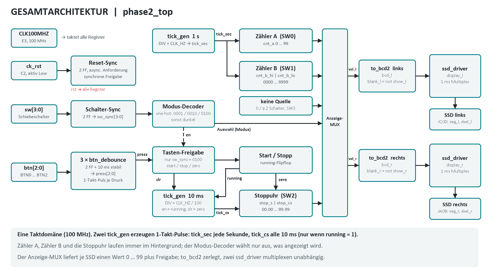

## 01 Einleitung, Ziel und Anforderungen

Phase II des Labors baut auf der 7-Segment-Ansteuerung aus Phase I auf. Laut Aufgabenstellung (Folie 212) ist eine 7-Segment-Anzeige mit Zähler zu implementieren, der im Sekundentakt von 0 bis 99 zählt und per Taster zurückgesetzt werden kann. Gefordert sind VHDL-Implementierung und Testbench, der Test per Simulation und am Board sowie Präsentation und Bericht mit Anhang (VHDL-Code, Testbench, Links).

Unsere Umsetzung erfüllt die Pflicht in der Betriebsart SW0 und erweitert sie – wie schon in Phase I – über die Schiebeschalter zu einem Mehrmodus-Design. Ein zweites Pmod SSD an den Pmod-Ports JC und JD verdoppelt die Anzeige auf vier Stellen. Damit entstehen zwei weitere Betriebsarten: ein vierstelliger Sekundenzähler 0000 … 9999 (SW1) und eine Stoppuhr mit Start, Stopp und Nullen über die Taster (SW2), die links Sekunden und rechts Hundertstelsekunden anzeigt.

Der Bericht beschreibt den implementierten Stand exakt. Die RTL-Simulation wurde mit GHDL 6.0.0 durchgeführt und bestanden – einschließlich eines vollständigen Durchlaufs bis 9999 → 0000 –; zusätzlich wurden alle synthetisierbaren Quellen mit GHDL im Modus VHDL-93 analysiert und synthetisiert. Ein Vivado-Build mit Timing-Analyse und der physische Boardtest sind noch offen und als Prüfliste in Kapitel 15 aufgeführt.

| ID | Anforderung | Umsetzung | Nachweis |
| --- | --- | --- | --- |
| P2-01 | Start nach Reset bei 0 | alle Zähler 0, Stoppuhr steht | TB „start“ |
| P2-02 | Ungültige Schalter: dunkel | show_l = show_r = 0 | TB: 6 Stellungen |
| P2-03 | SW0: Sekundentakt 0 … 99 (Pflicht) | tick_sec → cnt_a | TB: Sekunde 1 … 102 |
| P2-04 | SW0: 99 → 00 | Überlauf cnt_a | TB: Sekunde 100 |
| P2-05 | SW0: zweites SSD aus | show_l = 0 | TB: links dunkel |
| P2-06 | SW1: 0000 … 9999 über beide SSD | cnt_b_hi \| cnt_b_lo | TB „SW1 0103“ |
| P2-07 | SW1: 9999 → 0000 | Übertragskaskade | TB: 9998 … 10001 s |
| P2-08 | Zähler laufen im Hintergrund | tick_sec immer aktiv | TB: Moduswechsel |
| P2-09 | SW2: Start / Stopp, 10 ms | running, tick_cs | TB „2 s“ |
| P2-10 | SW2: Stand bleibt im Stopp | en = running | TB „hold“ |
| P2-11 | SW2: Nullen nur im Stopp | sw_zero mit running = 0 | TB: beide Fälle |
| P2-12 | SW2: 99.99 → 00.00, läuft weiter | Übertragskaskade | TB „overflow“ |
| P2-13 | Tasten nur in SW2 wirksam | Freigabe über sw_sync | TB: SW0/SW1 + Taster |
| P2-14 | Stoppuhr läuft im Hintergrund | running unabhängig vom Modus | TB „background“ |
| P2-15 | Reset per Taster (ck_rst) | rst → alle Register | TB „reset“ |

## 02 Hardware: Arty A7-35T und zwei Pmod SSD

Zielplattform ist wie in Phase I das Arty A7-35T mit dem FPGA xc7a35ticsg324-1L und einem 100-MHz-Oszillator an Pin E3. Verwendet werden die Schiebeschalter SW0 … SW3, die Taster BTN0 … BTN3 (gedrückt = 1) und der rote RESET-Taster ck_rst (gedrückt = 0). Alle Signale nutzen LVCMOS33.

Neu ist ein zweites Digilent Pmod SSD. Jedes Modul hat zwei Ziffern mit gemeinsamer Kathode, sieben gemeinsame Segmentleitungen AA … AG und einen Auswahlpin C, verteilt auf die Stecker J1 (AA … AD) und J2 (AE, AF, AG, C). Zwei Module benötigen damit 18 Signalleitungen und vier Pmod-Ports. Das rechte SSD bleibt unverändert an JA/JB (wie Phase I), das linke SSD wird an JC/JD angeschlossen.

Verdrahtung: Beide SSD werden an die UNTERE Reihe (Pins 7 … 12) der Pmod-Ports gesteckt – J1 an JA bzw. JC, J2 an JB bzw. JD. Die oberen Reihen (Pins 1 … 6) bleiben frei. Die Pinbelegung von JC/JD stammt aus dem Digilent-Master-XDC und ist identisch mit der im Uhrenprojekt (prj_clock) erprobten Zuordnung. Vor dem Umstecken die Versorgung trennen und GND/VCC-Orientierung prüfen.

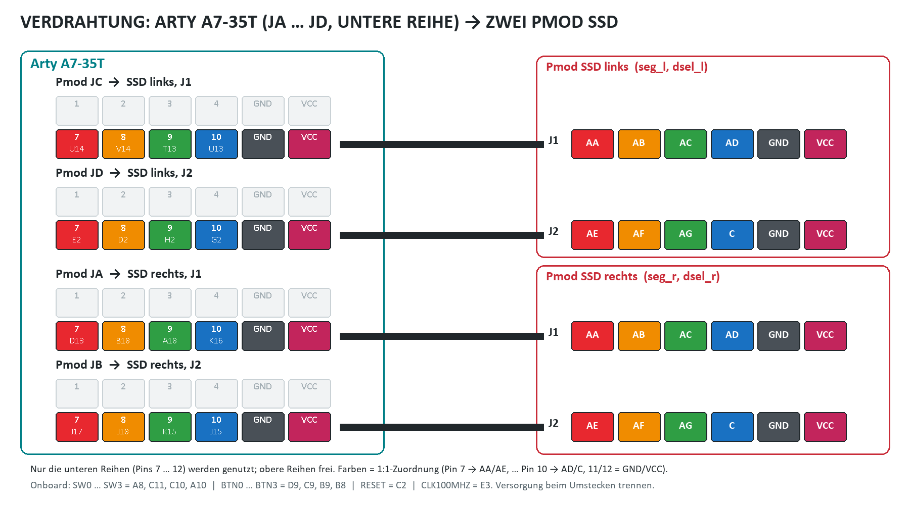

*Abbildung 1: Verdrahtung: JC/JD → linkes SSD, JA/JB → rechtes SSD, jeweils untere Reihe*

| Port | FPGA-Pin | Verbindung | Bedeutung |
| --- | --- | --- | --- |
| CLK100MHZ | E3 | Board-Oszillator | 100 MHz, Periode 10 ns |
| ck_rst | C2 | RESET-Taster (rot) | aktiv Low, setzt alles zurück |
| sw[0] | A8 | SW0 | Sekunden 00 … 99 |
| sw[1] | C11 | SW1 | Sekunden 0000 … 9999 |
| sw[2] | C10 | SW2 | Stoppuhr |
| sw[3] | A10 | SW3 | ohne Funktion (→ dunkel) |
| btn[0] | D9 | BTN0 | Stoppuhr Start |
| btn[1] | C9 | BTN1 | Stoppuhr Stopp |
| btn[2] | B9 | BTN2 | Stoppuhr Nullen (im Stopp) |
| btn[3] | B8 | BTN3 | ohne Funktion |
| seg_r[0 … 3] | D13, B18, A18, K16 | JA7 … JA10 → SSD rechts AA … AD | Segmente a … d |
| seg_r[4 … 6] | J17, J18, K15 | JB7 … JB9 → SSD rechts AE … AG | Segmente e … g |
| dsel_r | J15 | JB10 → SSD rechts C | Ziffernauswahl rechts |
| seg_l[0 … 3] | U14, V14, T13, U13 | JC7 … JC10 → SSD links AA … AD | Segmente a … d |
| seg_l[4 … 6] | E2, D2, H2 | JD7 … JD9 → SSD links AE … AG | Segmente e … g |
| dsel_l | G2 | JD10 → SSD links C | Ziffernauswahl links |

JB und JC sind beim Arty „High-Speed“-Pmods ohne Serienwiderstände, JA und JD „Standard“-Pmods mit 200-Ω-Schutzwiderständen. Für die langsam schaltenden Segmentleitungen (Umschaltung alle 1 ms) ist das unkritisch; beide SSD werden logisch identisch angesteuert. Eventuelle Helligkeitsunterschiede zwischen den Steckern sind beim Boardtest zu beobachten.

## 03 Funktionsweise der 7-Segment-Anzeige (Kurzfassung)

Die Grundlagen wurden im Bericht zu Phase I ausführlich behandelt und gelten unverändert. Dieses Kapitel fasst sie zusammen und ergänzt die Zuordnung für das zweite SSD.

### 3.1 Segmente und Bitreihenfolge

Eine Ziffer besteht aus sieben LED-Segmenten a … g. Im VHDL-Vektor seg(6 downto 0) steht Bit 6 für g und Bit 0 für a („gfedcba“); logisch 1 schaltet ein Segment ein (aktiv High, gemeinsame Kathode). Beide SSD nutzen dieselbe Reihenfolge: seg_r[i] und seg_l[i] treiben jeweils Segment i des rechten bzw. linken Moduls.

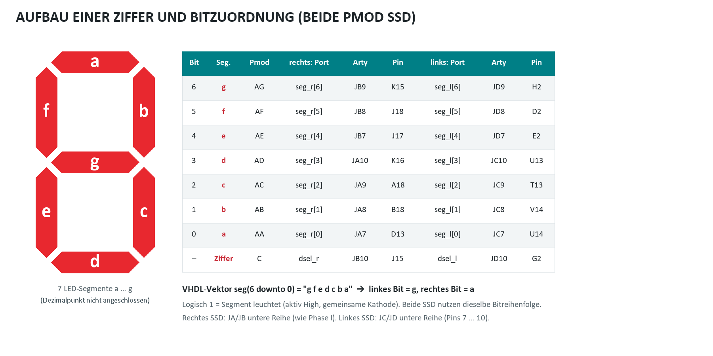

*Abbildung 2: Segmentbezeichnung und Zuordnung Bit → Pmod-Pin → Arty-Port → FPGA-Pin für beide SSD*

### 3.2 Gemeinsame Kathode und Zeitmultiplex

Innerhalb eines SSD sind die Anoden gleichnamiger Segmente beider Ziffern verbunden; der Pin C wählt, welche Kathode leitet. Es leuchtet je SSD also immer nur eine Ziffer, und beide Ziffern müssen zeitlich abwechselnd angesteuert werden. In Phase II gibt es zwei solche Module mit je eigenem C-Pin; sie werden von zwei unabhängigen, identischen Multiplexern (ssd_driver) angesteuert.

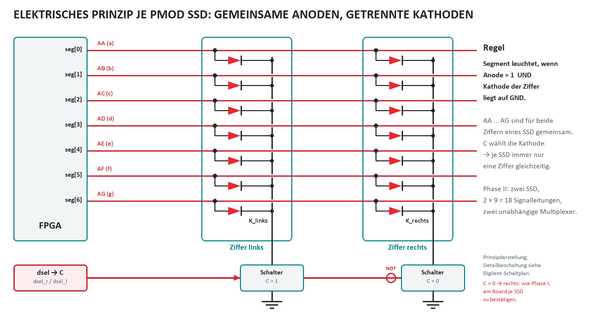

*Abbildung 3: Prinzipschaltung eines Pmod SSD*

Der seg7_decoder übersetzt eine BCD-Ziffer kombinatorisch in das Segmentmuster. Für den Eingang blank = 1 liefert er 0000000 – darüber werden in Phase II ganze SSD dunkel geschaltet.

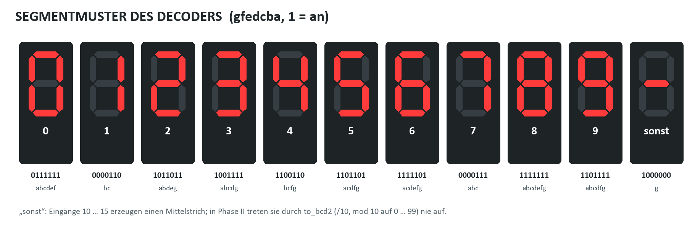

*Abbildung 4: Segmentmuster aller Dezimalziffern*

tick_gen im ssd_driver erzeugt mit DIV = CLK_HZ / (2 · REFRESH_HZ) = 100.000 alle 1 ms einen Puls, der die Ziffernauswahl umschaltet. Jede Ziffer wird mit 500 Hz und 50 % Tastverhältnis angesteuert – weit oberhalb der Flimmergrenze. Beide SSD werden auf diese Weise gleichzeitig, aber unabhängig gemultiplext.

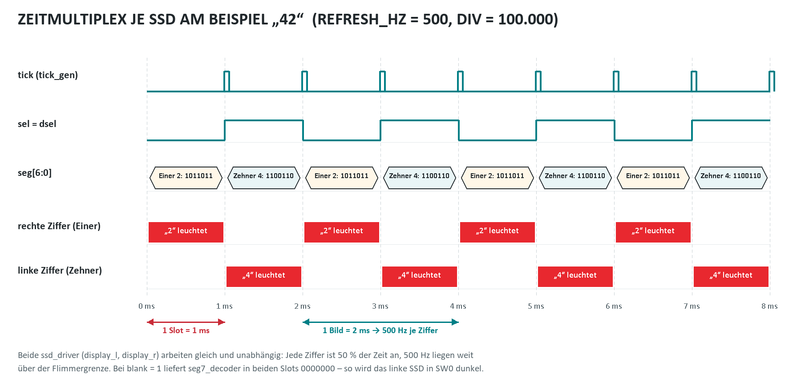

*Abbildung 5: Zeitmultiplex eines SSD am Beispiel 42*

## 04 Bedienkonzept und Betriebsarten

Wie in Phase I wählen die Schiebeschalter die Betriebsart; gültig ist nur eine Stellung mit genau einem Schalter auf 1 (one-hot). In Phase II sind drei Betriebsarten belegt: SW0, SW1 und SW2. SW3 allein und alle Stellungen mit keinem oder mehreren Schaltern schalten beide SSD dunkel. Die Taster wirken ausschließlich in der Betriebsart SW2 (Stoppuhr).

| sw (SW3 … SW0) | Betriebsart | SSD links (JC/JD) | SSD rechts (JA/JB) | Taster |
| --- | --- | --- | --- | --- |
| 0001 | SW0: Sekundenzähler | dunkel | 00 … 99 | keine Wirkung |
| 0010 | SW1: Sekundenzähler 4-stellig | Tausender \| Hunderter | Zehner \| Einer | keine Wirkung |
| 0100 | SW2: Stoppuhr | Sekunden 00 … 99 | Hundertstel 00 … 99 | BTN0 Start, BTN1 Stopp, BTN2 Nullen |
| 1000 | SW3: nicht belegt | dunkel | dunkel | keine Wirkung |
| 0000 / mehrere | keine gültige Wahl | dunkel | dunkel | keine Wirkung |

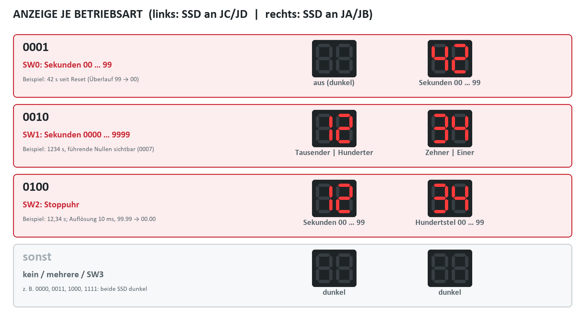

*Abbildung 6: Anzeige beider SSD je Betriebsart*

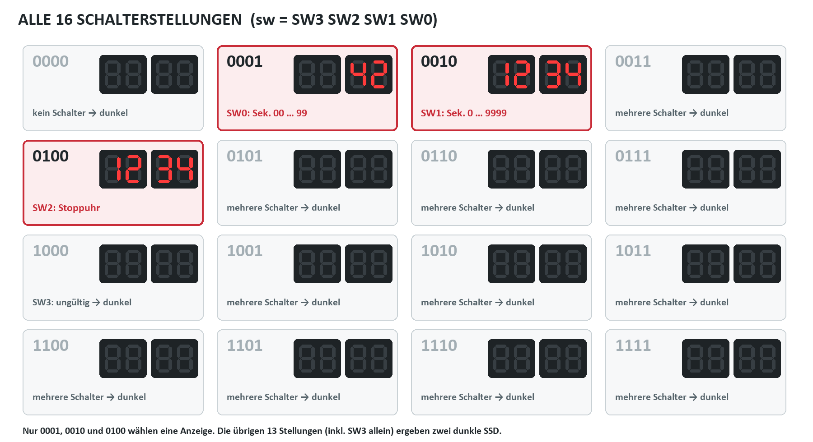

*Abbildung 7: Alle 16 Schalterstellungen mit resultierender Anzeige*

Getroffene Entwurfsentscheidungen, die über die Aufgabenstellung hinausgehen und deshalb explizit festgelegt wurden:

- Reset ausschließlich über den roten RESET-Taster ck_rst: Er setzt beide Sekundenzähler und die Stoppuhr auf 0 und hält die Stoppuhr an. Das erfüllt „Reset per Taster“.
- Zähler A (SW0) und Zähler B (SW1) sind getrennte Register. Beide laufen unabhängig von der Schalterstellung ab Reset im Hintergrund weiter; die Schalter wählen nur aus, was angezeigt wird. Da beide vom selben Sekundenpuls getaktet werden, gilt stets Zähler A = Zähler B mod 100.
- Überlauf: 99 → 00 (SW0), 9999 → 0000 (SW1), 99.99 → 00.00 (SW2); die Stoppuhr läuft dabei weiter.
- Alle Werte werden mit führender Null angezeigt (00, 0042, 01.50). Anders als in Phase I gibt es keine Unterdrückung führender Nullen – bei einer Uhr bzw. Stoppuhr ist die feste Stellenzahl lesbarer.
- Stoppuhr-Auflösung 10 ms (Hundertstel), weil das rechte SSD nur zwei Stellen hat. Bereich 00.00 … 99.99 s.
- Nullen (BTN2) ist nur im Stopp wirksam, damit eine laufende Messung nicht versehentlich gelöscht wird. Start bei laufender Uhr und Stopp bei stehender Uhr ändern nichts.
- Die Stoppuhr läuft beim Wechsel in einen anderen Modus weiter und kann erst nach Rückkehr zu SW2 angehalten werden.

## 05 Gesamtarchitektur

Das Design besitzt genau eine Taktdomäne: Alle Register werden mit CLK100MHZ getaktet. Langsame Vorgänge – 1 s, 10 ms, 1 ms Multiplex, 10 ms Entprellung – werden ausschließlich über Zähler und 1-Takt-Freigabepulse realisiert. Es gibt keinen abgeleiteten Takt; dadurch bleibt die Timing-Analyse einfach und es entstehen keine Taktdomänenübergänge.

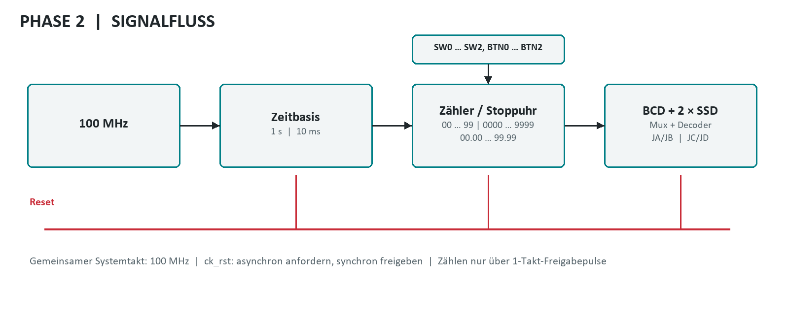

*Abbildung 8: Signalfluss Phase II*

Der Datenfluss im Detail: Reset und Schalter werden synchronisiert, die Taster BTN0 … BTN2 zusätzlich entprellt. Zwei tick_gen-Instanzen bilden die Zeitbasis: u_tick_sec liefert jede Sekunde einen Puls für beide Sekundenzähler, u_tick_cs alle 10 ms einen Puls für die Stoppuhr – aber nur, solange running = 1 ist. Die Tasten-Freigabe lässt Start, Stopp und Nullen nur in der Betriebsart SW2 durch. Der Anzeige-MUX wählt je SSD einen Wert 0 … 99 und eine Freigabe; to_bcd2 zerlegt die Werte in Ziffern, zwei ssd_driver geben sie aus.


*Abbildung 9: Gesamtblockschaltbild von phase2_top*

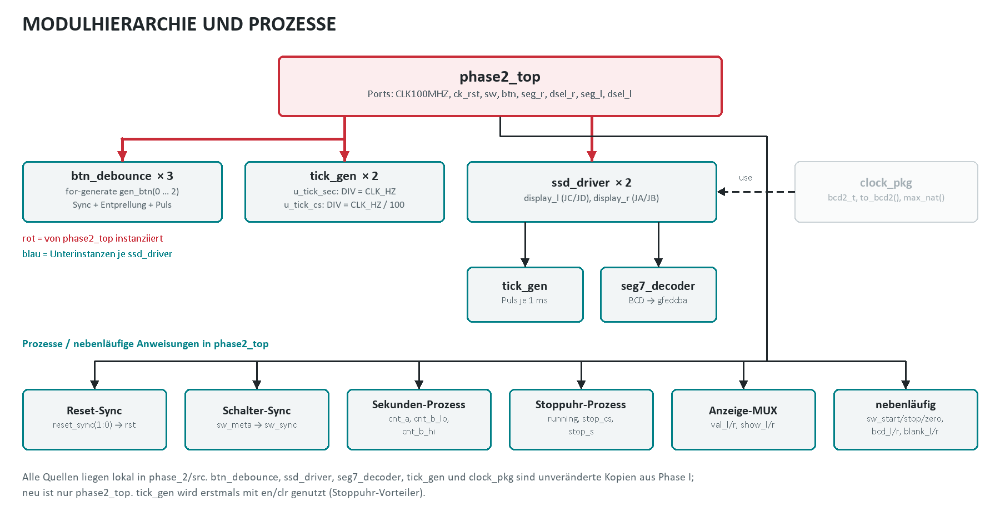

*Abbildung 10: Modulhierarchie und Prozesse*

| Signal | Typ / Bereich | Bedeutung |
| --- | --- | --- |
| rst | std_logic | synchron freigegebener Reset (reset_sync(1)) |
| sw_sync | std_logic_vector(3 downto 0) | synchronisierte Schalter |
| press | std_logic_vector(2 downto 0) | 1-Takt-Puls je Druck auf BTN0 … BTN2 |
| tick_sec / tick_cs | std_logic | 1-Takt-Puls je Sekunde / je 10 ms (bei running) |
| cnt_a | natural range 0 to 99 | Zähler A (SW0) |
| cnt_b_hi, cnt_b_lo | natural range 0 to 99 | Zähler B (SW1), Tausender/Hunderter bzw. Zehner/Einer |
| running | std_logic | Stoppuhr läuft |
| sw_start / sw_stop / sw_zero | std_logic | freigegebene Tastenpulse der Stoppuhr |
| stop_s, stop_cs | natural range 0 to 99 | Stoppuhr: Sekunden / Hundertstel |
| val_l, val_r | natural range 0 to 99 | anzuzeigender Wert je SSD |
| show_l, show_r | std_logic | Freigabe je SSD |
| bcd_l, bcd_r | bcd2_t (Record tens/ones) | BCD-Ziffern je SSD |
| blank_l, blank_r | std_logic | Dunkelschaltung je SSD (not show) |

## 06 Eingangsstufe und Zeitbasis

### 6.1 Reset, Schalter und Taster

Reset- und Schaltersynchronisation sind unverändert aus Phase I übernommen: ck_rst (aktiv Low) setzt die zweistufige Kette reset_sync asynchron, die Freigabe erfolgt synchron nach zwei Taktflanken. Die Schalter durchlaufen zwei Flipflops gegen Metastabilität. Nach dem Loslassen des Resets beginnt auch der Sekundenvorteiler neu – das erste Sekundenintervall ist also vollständig.

```vhdl
process (CLK100MHZ, ck_rst)
begin
    if ck_rst = '0' then
        reset_sync <= (others => '1');
    elsif rising_edge(CLK100MHZ) then
        reset_sync <= reset_sync(0) & '0';
    end if;
end process;

rst <= reset_sync(1);

process (CLK100MHZ)
begin
    if rising_edge(CLK100MHZ) then
        sw_meta <= sw;
        sw_sync <= sw_meta;
```

Die Taster BTN0 … BTN2 werden mit drei Instanzen des unveränderten btn_debounce aus Phase I verarbeitet (for-generate gen_btn). Jeder akzeptierte Druck erzeugt nach 10 ms Stabilität genau einen 1-Takt-Puls; Halten oder Loslassen erzeugen keine weiteren Pulse. BTN3 ist in Phase II ohne Funktion und wird nicht ausgewertet.

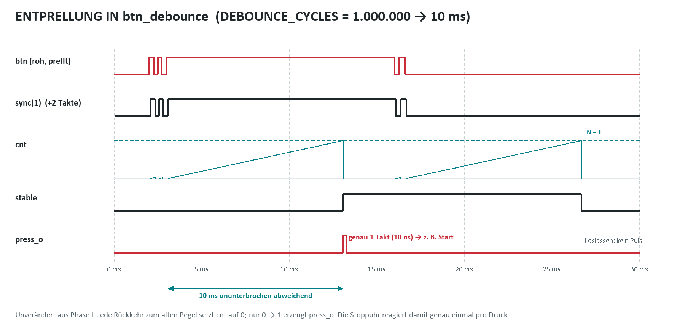

*Abbildung 11: Zeitverlauf der Entprellung (unverändert aus Phase I)*

```vhdl
        if rst = '1' then
            sync   <= (others => '0');
            stable <= '0';
            cnt    <= 0;
        else
            sync <= sync(0) & btn_i;
            if sync(1) = stable then
                cnt <= 0;
            elsif cnt = DEBOUNCE_CYCLES - 1 then
                cnt    <= 0;
                stable <= sync(1);
                -- nur die akzeptierte Low->High-Flanke erzeugt einen Puls
                press  <= sync(1);
            else
                cnt <= cnt + 1;
            end if;
        end if;
    end if;
end process;

press_o <= press;
```

### 6.2 Zeitbasis mit zwei tick_gen-Instanzen

Für die Zeitbasis wird der vorhandene generische Pulsgeber tick_gen zweimal instanziiert. u_tick_sec mit DIV = CLK_HZ = 100.000.000 liefert genau jede Sekunde einen Puls tick_sec. u_tick_cs mit DIV = CLK_HZ / 100 = 1.000.000 liefert alle 10 ms einen Puls tick_cs. Für die Stoppuhr werden erstmals die bereits vorhandenen Eingänge en und clr von tick_gen genutzt: en = running hält den Vorteiler im Stopp an, ohne seinen Stand zu verlieren; clr = sw_zero setzt ihn beim Nullen zurück.

```vhdl
if rst = '1' or clr = '1' then
    cnt  <= 0;
    tick <= '0';
elsif en = '1' then
    if cnt = DIV - 1 then
        cnt  <= 0;
        tick <= '1';
    else
        cnt  <= cnt + 1;
        tick <= '0';
    end if;
else
    tick <= '0';
end if;
```

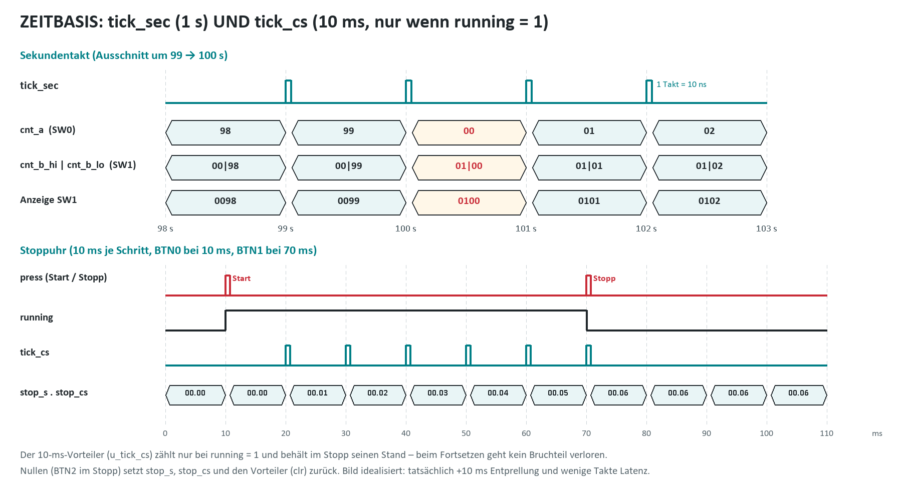

*Abbildung 12: Zeitbasis: Sekundenpuls mit Zählerübergang 0099 → 0100 und Stoppuhr mit Start/Stopp*

| Größe | Formel | Wert (Board) | Wert (Simulation) |
| --- | --- | --- | --- |
| Systemtakt | CLK_HZ | 100 MHz | 1 kHz (Periode 10 ns, skaliert) |
| Sekundenpuls | DIV = CLK_HZ | 100.000.000 Takte = 1 s | 1.000 Takte |
| Stoppuhr-Puls | DIV = CLK_HZ / 100 | 1.000.000 Takte = 10 ms | 10 Takte |
| Multiplex-Slot | CLK_HZ / (2 · REFRESH_HZ) | 100.000 Takte = 1 ms | 5 Takte |
| Entprellung | DEBOUNCE_CYCLES | 1.000.000 Takte = 10 ms | 4 Takte |

### 6.3 Tasten-Freigabe

Die Freigabe der Stoppuhr-Tasten ist als drei nebenläufige Zuweisungen formuliert. sw_start und sw_stop sind nur bei sw_sync = 0100 aktiv; sw_zero zusätzlich nur bei running = 0. In allen anderen Betriebsarten werden die press-Pulse verworfen – sie verändern weder running noch den Stoppuhrstand.

```vhdl
sw_start <= '1' when sw_sync = MODE_STOP and press(0) = '1' else '0';
sw_stop  <= '1' when sw_sync = MODE_STOP and press(1) = '1' else '0';
sw_zero  <= '1' when sw_sync = MODE_STOP and press(2) = '1' and running = '0' else '0';

u_tick_sec : entity work.tick_gen
    generic map (DIV => CLK_HZ)
    port map (clk => CLK100MHZ, rst => rst, tick => tick_sec);

-- Vorteiler haelt im Stopp seinen Stand, Nullen setzt ihn mit zurueck
u_tick_cs : entity work.tick_gen
    generic map (DIV => CS_DIV)
    port map (clk => CLK100MHZ, rst => rst, en => running, clr => sw_zero, tick => tick_cs);
```

## 07 Betriebsart SW0: Sekundenzähler 00 … 99

Die Betriebsart SW0 erfüllt die Pflichtaufgabe: Ein Zähler zählt im Sekundentakt von 0 bis 99 und beginnt danach wieder bei 0; der Reset-Taster setzt ihn zurück. cnt_a wird bei jedem tick_sec um 1 erhöht, bei 99 auf 0 gesetzt. Angezeigt wird der Wert zweistellig auf dem rechten SSD (JA/JB); das linke SSD an JC/JD bleibt dunkel.

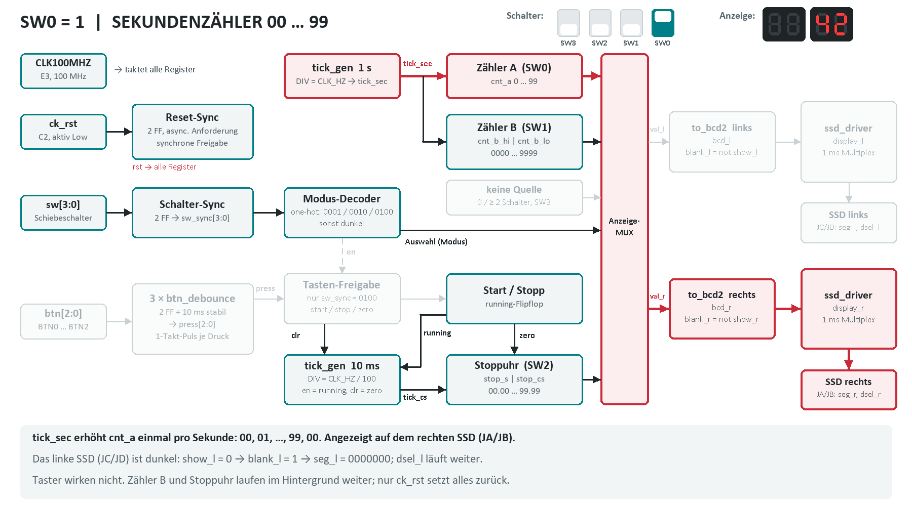

*Abbildung 13: Aktiver Datenpfad in Betriebsart SW0*

Das linke SSD wird über show_l = 0 abgeschaltet: blank_l = 1 erzwingt im seg7_decoder das Muster 0000000 in beiden Zeitschlitzen, während dsel_l weiter umschaltet. Elektrisch fließt damit kein Segmentstrom. Die Taster sind in SW0 wirkungslos; Zähler B und eine laufende Stoppuhr zählen im Hintergrund weiter.

| Zeit seit Reset | cnt_a | SSD links | SSD rechts |
| --- | --- | --- | --- |
| 0 … < 1 s | 0 | dunkel | 00 |
| 1 s | 1 | dunkel | 01 |
| 42 s | 42 | dunkel | 42 |
| 99 s | 99 | dunkel | 99 |
| 100 s | 0 | dunkel | 00 |
| 101 s | 1 | dunkel | 01 |

## 08 Betriebsart SW1: Sekundenzähler 0000 … 9999

In der Betriebsart SW1 werden beide SSD genutzt: Ein vierstelliger Zähler zählt die Sekunden seit dem Reset von 0000 bis 9999 (2 h 46 min 39 s) und beginnt dann wieder bei 0000. Das linke SSD zeigt Tausender und Hunderter, das rechte Zehner und Einer; führende Nullen werden angezeigt.

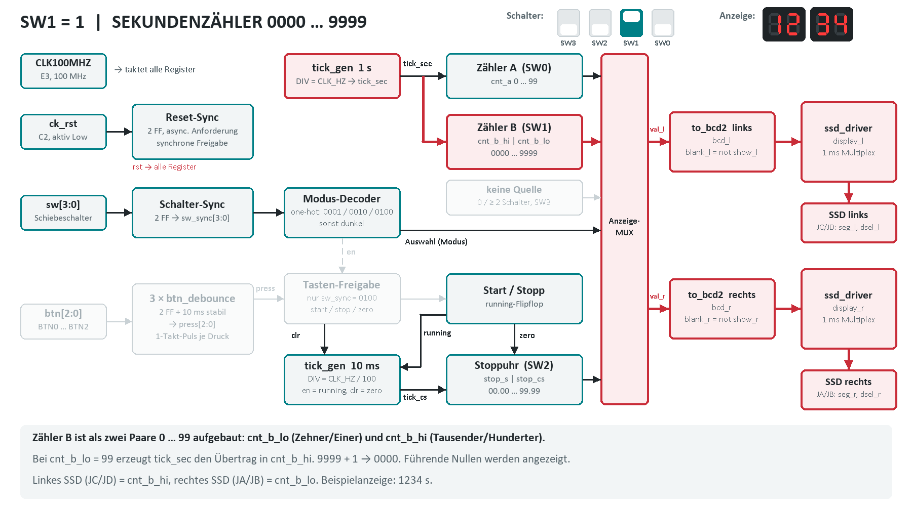

*Abbildung 14: Aktiver Datenpfad in Betriebsart SW1*

Zähler B ist nicht als ein Binärzähler 0 … 9999 aufgebaut, sondern als Kaskade zweier Stufen 0 … 99: cnt_b_lo zählt jede Sekunde; erreicht es 99, wird es beim nächsten Puls 0 und cnt_b_hi um 1 erhöht (Übertrag). Bei 99|99 laufen beide Stufen auf 0. Diese Aufteilung passt direkt auf die beiden SSD: Jede Stufe wird mit derselben Funktion to_bcd2 (÷ 10, mod 10 auf 7 Bit) in zwei Ziffern zerlegt. Eine Zerlegung eines 14-Bit-Werts mit ÷ 1000 und ÷ 100 entfällt.

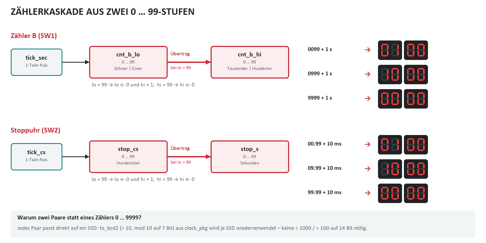

*Abbildung 15: Zählerkaskade aus zwei 0 … 99-Stufen für SW1 und SW2*

Zähler A und Zähler B werden im selben Prozess vom gleichen tick_sec getaktet:

```vhdl
elsif tick_sec = '1' then
    if cnt_a = 99 then
        cnt_a <= 0;
    else
        cnt_a <= cnt_a + 1;
    end if;

    if cnt_b_lo = 99 then
        cnt_b_lo <= 0;
        if cnt_b_hi = 99 then
            cnt_b_hi <= 0;
        else
            cnt_b_hi <= cnt_b_hi + 1;
        end if;
    else
        cnt_b_lo <= cnt_b_lo + 1;
```

| Zeit seit Reset | cnt_b_hi | cnt_b_lo | Anzeige |
| --- | --- | --- | --- |
| 7 s | 0 | 7 | 00 \| 07 |
| 99 s | 0 | 99 | 00 \| 99 |
| 100 s | 1 | 0 | 01 \| 00 |
| 1234 s | 12 | 34 | 12 \| 34 |
| 9999 s | 99 | 99 | 99 \| 99 |
| 10000 s | 0 | 0 | 00 \| 00 |

## 09 Betriebsart SW2: Stoppuhr

In der Betriebsart SW2 arbeitet das Design als Stoppuhr mit einer Auflösung von 10 ms. Das linke SSD zeigt die Sekunden 00 … 99, das rechte die Hundertstel 00 … 99. BTN0 startet, BTN1 stoppt, BTN2 setzt im Stopp auf 00.00 zurück.

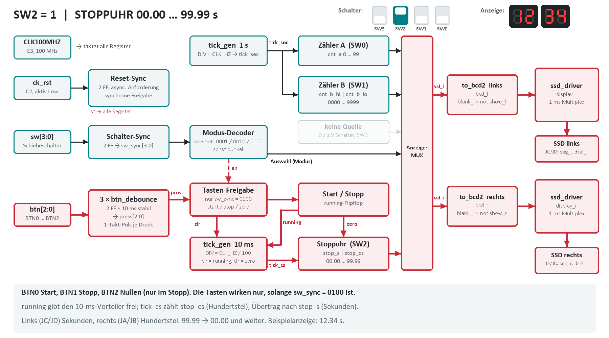

*Abbildung 16: Aktiver Datenpfad in Betriebsart SW2*

### 9.1 Zustände und Tasten

Die Steuerung besteht aus einem einzigen Flipflop running mit den Zuständen GESTOPPT (0) und LÄUFT (1). sw_start setzt running, sw_stop löscht es; treffen beide im selben Takt ein, hat Start Vorrang (praktisch ausgeschlossen, da zwei entprellte Pulse exakt gleichzeitig kommen müssten). Nullen ist nur im Zustand GESTOPPT wirksam. Nach dem Reset ist die Stoppuhr gestoppt und steht auf 00.00.

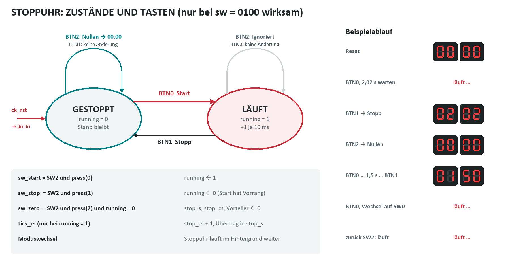

*Abbildung 17: Zustände der Stoppuhr, Tastenwirkung und Beispielablauf*

### 9.2 Zählwerk

Das Zählwerk ist wie Zähler B eine Kaskade zweier 0 … 99-Stufen: stop_cs (Hundertstel) zählt jeden tick_cs; bei 99 folgt der Übertrag nach stop_s (Sekunden). Nach 99.99 laufen beide auf 00.00, die Stoppuhr zählt weiter. Nullen hat Vorrang vor einem gleichzeitigen tick_cs.

```vhdl
if sw_start = '1' then
    running <= '1';
elsif sw_stop = '1' then
    running <= '0';
end if;

if sw_zero = '1' then
    stop_cs <= 0;
    stop_s  <= 0;
elsif tick_cs = '1' then
    if stop_cs = 99 then
        stop_cs <= 0;
        if stop_s = 99 then
            stop_s <= 0;
        else
            stop_s <= stop_s + 1;
        end if;
    else
        stop_cs <= stop_cs + 1;
```

### 9.3 Genauigkeit

- Auflösung: 10 ms. Die Anzeige zeigt die abgeschlossenen Hundertstel (abgeschnitten, nicht gerundet).
- Zeitbasis: 1.000.000 Takte des 100-MHz-Oszillators je Schritt; die Genauigkeit entspricht der des Board-Oszillators.
- Latenz: Start und Stopp werden beide durch die Entprellung um 10 ms plus wenige Takte verzögert. Da die Verzögerung für beide Flanken gleich ist, hebt sie sich in der gemessenen Dauer auf.
- Unterbrechung: Im Stopp hält der Vorteiler seinen Stand (en = running). Beim Fortsetzen geht kein angefangenes Hundertstel verloren; Start/Stopp-Folgen summieren sich korrekt.
- Nullen setzt auch den Vorteiler zurück (clr), sodass nach dem nächsten Start genau 10 ms bis zur ersten Hundertstel vergehen.

## 10 Ungültige Schalterstellungen

Steht kein Schalter, nur SW3 oder stehen mehrere Schalter auf 1, gibt es keine eindeutige Betriebsart. Der Anzeige-MUX setzt dann show_l = show_r = 0 (when-others-Zweig). Beide seg7_decoder erhalten blank = 1 und geben 0000000 aus; die ssd_driver laufen unverändert weiter. Die Taster werden ignoriert. Alle Zähler und eine laufende Stoppuhr zählen im Hintergrund weiter.

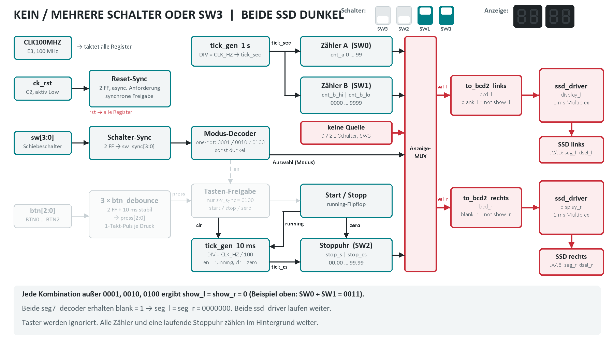

*Abbildung 18: Datenpfad bei ungültiger Schalterstellung (Beispiel 0011)*

Die Auswahl für beide SSD trifft eine einzige case-Anweisung. Werte und Freigaben entstehen aus demselben Vergleich und können daher nie widersprüchlich sein:

```vhdl
process (sw_sync, cnt_a, cnt_b_lo, cnt_b_hi, stop_cs, stop_s)
begin
    val_l  <= 0;
    val_r  <= 0;
    show_l <= '0';
    show_r <= '0';
    case sw_sync is
        when MODE_SEC99 =>
            val_r <= cnt_a;    show_r <= '1';
        when MODE_SEC9999 =>
            val_l <= cnt_b_hi; show_l <= '1';
            val_r <= cnt_b_lo; show_r <= '1';
        when MODE_STOP =>
            val_l <= stop_s;   show_l <= '1';
            val_r <= stop_cs;  show_r <= '1';
        when others =>
            null;
    end case;
end process;
```

## 11 Anzeigepfad mit zwei Treibern

Je SSD gibt es einen eigenen, identischen Anzeigepfad. Der Wert val_l bzw. val_r (0 … 99) wird mit to_bcd2 aus clock_pkg in Zehner und Einer zerlegt. Das Ergebnis ist ein Record vom Typ bcd2_t; seine Elemente tens und ones werden direkt an die Ports digit1 und digit0 des ssd_driver gelegt. Die Freigabe wird invertiert an den Port blank angeschlossen.

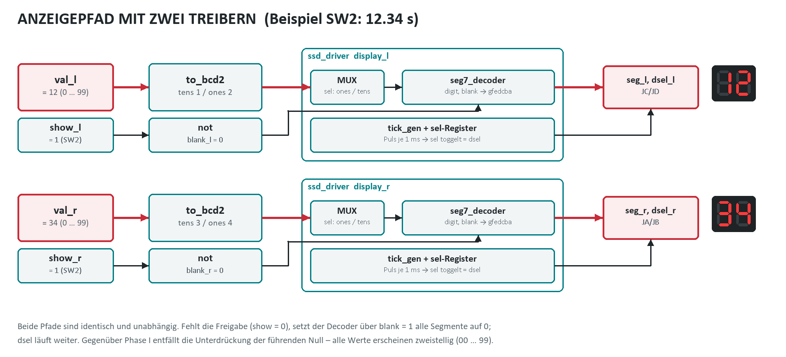

*Abbildung 19: Anzeigepfad beider SSD am Beispiel der Stoppuhr 12.34 s*

Gegenüber Phase I entfällt die externe Ausblendung im Top-Level (show_tens): Da alle Werte zweistellig angezeigt werden, genügt der blank-Eingang des ssd_driver, der schon im Weckerprojekt vorhanden war. Damit bleibt das Top-Level schlanker; ssd_driver und seg7_decoder sind unverändert.

```vhdl
bcd_l   <= to_bcd2(to_unsigned(val_l, 7));
bcd_r   <= to_bcd2(to_unsigned(val_r, 7));
blank_l <= not show_l;
blank_r <= not show_r;

display_r : entity work.ssd_driver
    generic map (CLK_HZ => CLK_HZ, REFRESH_HZ => REFRESH_HZ)
    port map (
        clk    => CLK100MHZ,
        rst    => rst,
        digit0 => bcd_r.ones,
        digit1 => bcd_r.tens,
        blank  => blank_r,
        seg    => seg_r,
        dsel   => dsel_r
```

Die beiden ssd_driver besitzen je einen eigenen tick_gen für den 1-ms-Takt. Sie laufen nach dem Reset synchron, sind aber logisch unabhängig. Eine gemeinsame Nutzung des Multiplex-Pulses wäre möglich, brächte aber nur wenige Flipflops Ersparnis und würde den unveränderten Treiber modifizieren.

## 12 Wiederverwendung aus Phase I und Dateien

Alle Quellen liegen lokal in phase_2/src; das Projekt ist eigenständig. Neu ist nur phase2_top.vhd. Alle übrigen Module sind unveränderte Kopien aus Phase I – dort teils bereits aus dem Weckerprojekt übernommen. Das zeigt den Nutzen einer generischen Modulbibliothek: tick_gen wird mit anderen Generics als Sekunden- und 10-ms-Vorteiler genutzt, ssd_driver zweimal instanziiert.

| Datei | Inhalt | Status ggü. Phase I |
| --- | --- | --- |
| src/phase2_top.vhd | Top-Level: Sync, Zeitbasis, Zähler, Stoppuhr, Anzeige-MUX | neu |
| src/btn_debounce.vhd | Synchronisation, Entprellung, 1-Takt-Puls (3 Instanzen) | unverändert |
| src/tick_gen.vhd | generischer Pulsgeber, jetzt auch mit en/clr genutzt | unverändert |
| src/ssd_driver.vhd | Multiplex zweier Ziffern (2 Instanzen) | unverändert |
| src/seg7_decoder.vhd | BCD → gfedcba, blank | unverändert |
| src/clock_pkg.vhd | bcd2_t, to_bcd2(), max_nat() | unverändert |
| sim/tb_phase2_top.vhd | selbstprüfende Testbench beider SSD | neu |
| constraints/arty_a7_35_ssd.xdc | Pins, IO-Standard, Takt | erweitert um seg_l, dsel_l |
| scripts/run_sim.ps1 | GHDL-Simulation, Wellenform optional (-Wave) | angepasst |
| scripts/create_project.tcl | Vivado-Projekt | unverändert |

Die Generics CLK_HZ, DEBOUNCE_CYCLES und REFRESH_HZ trennen Logik und Zeitkonstanten. Alle abgeleiteten Teiler (1 s, 10 ms, 1 ms) werden aus CLK_HZ berechnet; die Testbench verkleinert CLK_HZ und prüft damit dieselbe Logik in kurzer Simulationszeit.

Der synthetisierbare Code verwendet ausschließlich VHDL-93-Sprachmittel (bedingte Zuweisungen nur nebenläufig, keine Ausdrücke in Port-Maps; Record-Elemente wie bcd_r.ones sind als Port-Aktual zulässig). Analyse und Synthese aller Quellen mit GHDL im Modus --std=93c liefen fehlerfrei. Das Vivado-Projekt wird als VHDL-2008 angelegt, weil die Testbench std.env.finish verwendet.

## 13 Pin-Constraints und Vivado-Ablauf

constraints/arty_a7_35_ssd.xdc ordnet alle 26 Ports zu, setzt LVCMOS33 und beschreibt den 100-MHz-Takt (create_clock, Periode 10 ns). Gegenüber Phase I sind die acht Signale des linken SSD hinzugekommen; die Schalter, Taster und das rechte SSD sind unverändert.

```vhdl
## Pmod SSD links: JC Pins 7-10 = AA..AD, JD Pins 7-10 = AE, AF, AG, C
set_property -dict { PACKAGE_PIN U14 IOSTANDARD LVCMOS33 } [get_ports {seg_l[0]}]
set_property -dict { PACKAGE_PIN V14 IOSTANDARD LVCMOS33 } [get_ports {seg_l[1]}]
set_property -dict { PACKAGE_PIN T13 IOSTANDARD LVCMOS33 } [get_ports {seg_l[2]}]
set_property -dict { PACKAGE_PIN U13 IOSTANDARD LVCMOS33 } [get_ports {seg_l[3]}]
set_property -dict { PACKAGE_PIN E2  IOSTANDARD LVCMOS33 } [get_ports {seg_l[4]}]
set_property -dict { PACKAGE_PIN D2  IOSTANDARD LVCMOS33 } [get_ports {seg_l[5]}]
set_property -dict { PACKAGE_PIN H2  IOSTANDARD LVCMOS33 } [get_ports {seg_l[6]}]
set_property -dict { PACKAGE_PIN G2  IOSTANDARD LVCMOS33 } [get_ports dsel_l]
```

Projektanlage: Im Ordner phase_2 „vivado -mode gui -source scripts/create_project.tcl“ ausführen oder im Vivado-Tcl-Terminal „source scripts/create_project.tcl“. Das Skript erkennt die Phase am Ordnernamen, legt das Projekt unter vivado/ an und setzt phase2_top bzw. tb_phase2_top als Top-Level. Danach: Behavioral Simulation, Synthesis, Implementation, Report Timing Summary / DRC, Generate Bitstream, Hardware Manager.

Hinweis zur Behavioral Simulation in Vivado: Die Testbench simuliert über 10.000 beschleunigte Sekunden (≈ 10 Mio. Takte). In xsim dauert das deutlich länger als in GHDL; für einen schnellen Blick genügt es, die Simulation nach den ersten Abschnitten abzubrechen.

| Prüfpunkt | Akzeptanzkriterium |
| --- | --- |
| Top-Level | phase2_top / tb_phase2_top |
| Part | xc7a35ticsg324-1L |
| Ports | alle 26 Ports zugeordnet, keine unconstrained-IO-Warnung |
| Timing | 10-ns-Takt, WNS und WHS ≥ 0 |
| Bitstream | erzeugt und auf das Board geladen |

## 14 Simulation und Testergebnisse

tb_phase2_top ist selbstprüfend und betrachtet das Design als Black Box: Assertions prüfen nur die externen Ausgänge seg_r/dsel_r und seg_l/dsel_l gegen unabhängig in der Testbench hinterlegte Segmentmuster. Die Prozedur read_ssd beobachtet beide SSD über 12 Takte, dekodiert jedes Muster zurück in eine Ziffer, verlangt, dass jeder der vier Zeitschlitze gesehen wird und sich innerhalb des Fensters nicht ändert, und liefert je SSD einen Wert 0 … 99 oder „dunkel“. Ein nur halb dunkles SSD oder ein ungültiges Muster ist ein Fehler.

Simulationsparameter: CLK_HZ = 1000 (1 s = 1.000 Takte, 10 ms = 10 Takte), DEBOUNCE_CYCLES = 4, REFRESH_HZ = 100 (Zeitschlitz = 5 Takte). Um Sekundenwerte deterministisch zu prüfen, misst die Testbench den Zeitpunkt des ersten Sekundenpulses und liest danach jeden Sekundenwert in der Mitte seines Intervalls (wait_second). Lange Wartezeiten werden mit wait for übersprungen; so lässt sich der Überlauf bei 10.000 s in rund 40 s Rechenzeit prüfen.

```vhdl
procedure wait_second(n : natural) is
begin
    if n * SEC + offset > cyc + 100 then
        wait for (n * SEC + offset - cyc - 50) * 10 ns;
    end if;
    loop
        wait until falling_edge(clk);
        exit when (cyc - offset) / SEC = n
              and (cyc - offset) mod SEC >= 300
              and (cyc - offset) mod SEC <= 600;
    end loop;
end procedure;
```

| ID | Stimulus | Erwartung |
| --- | --- | --- |
| P2-01 | Reset, sw = 0001 / 0010 / 0100 | – \| 00, 00 \| 00, 00 \| 00 |
| P2-02 | 0000, 0011, 0101, 0110, 1000, 1111 | beide SSD dunkel |
| P2-03/04/05 | SW0, Sekunde 1 … 102 | – \| n mod 100, links dunkel |
| P2-06 | SW1 bei 103 s, 104 s | 01 \| 03, 01 \| 04 |
| P2-08 | SW0 bei 105 s, SW1 nach Stoppuhrtests | – \| 05, aktueller Sekundenstand |
| P2-07 | SW1 bei 9998 … 10001 s | 99\|98, 99\|99, 00\|00, 00\|01 |
| P2-09 | Start, 2.000 Takte, Stopp | 02.00 … 02.05 |
| P2-10 | 3.000 Takte warten | Wert unverändert |
| P2-11 | Nullen bei laufender Uhr | ignoriert, Wert läuft weiter |
| P2-13 | BTN0/BTN2 in SW0 und SW1 | Stoppuhr unverändert |
| P2-11 | Nullen im Stopp | 00 \| 00 |
| P2-14 | Start, 3.000 Takte in SW0, zurück, Stopp | 03.00 … 03.10 |
| P2-12 | Start, 100,5 s | 00.45 … 00.60 |
| P2-15 | Reset bei laufender Stoppuhr | alles 0, Stoppuhr steht |

Ergebnis mit GHDL 6.0.0: „PASS: phase 2 SW0 00..99 (1 s, 99->00, left dark), SW1 0000..9999 (9999->0000), SW2 stopwatch (start/stop/zero, 10 ms, 99.99->00.00, background), buttons only in SW2, invalid switches dark, reset“ nach 101.151.070 ns Simulationszeit, ohne Assertion-Fehler. Das Protokoll liegt in sim/testergebnis.txt. Aufruf aus dem Ordner phase_2: ./scripts/run_sim.ps1 -Ghdl <Pfad zu ghdl.exe> [-Wave]. Ohne -Wave wird keine Wellenform geschrieben, da sie für 10 Mio. Takte mehrere 100 MB groß wird.

Gegenprobe der Testbench: In einer Kopie des Designs wurde die SW2-Freigabe des Start-Tasters entfernt. Die Testbench bricht dann mit einer Assertion ab („buttons outside SW2 changed the stopwatch“). Die Tests erkennen also tatsächlich Fehlverhalten und laufen nicht nur durch.

Grenzen der Simulation: Die Zeitkonstanten sind verkleinert; geprüft wird die Logik, nicht die absolute Ganggenauigkeit des Oszillators. Prellen realer Taster, Helligkeit, Ghosting und die korrekte Steckerorientierung lassen sich nur am Board prüfen.

## 15 Boardabnahme, Fazit und Quellen

Die logischen Anforderungen sind in der RTL-Simulation nachgewiesen. Offen sind Synthese, Implementation und Timing-Analyse in Vivado sowie der Boardtest. Die folgende Prüfliste ist ein Abnahmeplan; Datum, Vivado-Version und Beobachtungen werden beim Test eingetragen.

- [ ] Verdrahtung bei ausgeschalteter Versorgung geprüft (JA/JB und JC/JD jeweils untere Reihe, GND/VCC)
- [ ] Alle Schalter aus: beide SSD dunkel; SW3 allein: dunkel
- [ ] SW0: rechts 00, 01, 02 … im Sekundentakt (mit Handy-Stoppuhr über 60 s vergleichen); links dunkel
- [ ] SW0: Überlauf 99 → 00 beobachten; RESET setzt auf 00
- [ ] SW1: vier Stellen, z. B. 0123; Übergang xx99 → (xx+1)00 korrekt
- [ ] Linke/rechte Ziffer je SSD richtig zugeordnet (sonst dsel invertieren); linkes/rechtes SSD nicht vertauscht
- [ ] SW2: BTN0 startet, BTN1 stoppt, Anzeige s | Hundertstel; BTN2 im Stopp → 00.00, während des Laufs ohne Wirkung
- [ ] SW2: Stoppuhr starten, auf SW0 wechseln, zurück auf SW2: Stoppuhr läuft weiter
- [ ] Taster in SW0/SW1 ohne Wirkung
- [ ] kein sichtbares Flackern oder Ghosting; Helligkeit beider SSD vergleichbar; Timing-Bericht ohne Verletzungen

Fazit: Phase II erfüllt die Pflichtaufgabe – Sekundenzähler 0 … 99 mit Reset per Taster – in der Betriebsart SW0 und erweitert sie um einen vierstelligen Sekundenzähler und eine Stoppuhr mit 10 ms Auflösung auf zwei SSD. Der Aufbau trennt wie in Phase I Eingabe, Zustand und Anzeige. Bis auf das Top-Level wurden alle Module unverändert aus Phase I übernommen; neu sind nur die Zeitbasis aus zwei tick_gen, die Übertragskaskaden und der Anzeige-MUX für zwei SSD. Die Struktur ist damit eine direkte Vorstufe für die Uhr bzw. den Wecker in Phase III.

Aufgabenstellung: Laborfolie „Labor: 7-Segment-Anzeige“, Phase II (Folie 212), phase_2/task/image5.png.

Digilent Arty A7 Reference Manual: https://digilent.com/reference/programmable-logic/arty-a7/reference-manual

Digilent Pmod SSD Reference Manual: https://digilent.com/reference/pmod/pmodssd/reference-manual

Digilent Master-XDC: https://github.com/Digilent/digilent-xdc/blob/master/Arty-A7-35-Master.xdc

GHDL-Dokumentation: https://ghdl.github.io/ghdl/

Lokale Referenz: phase_1 (Module und Testmethodik), prj_clock (Pinbelegung JC/JD für ein zweites Pmod SSD).
