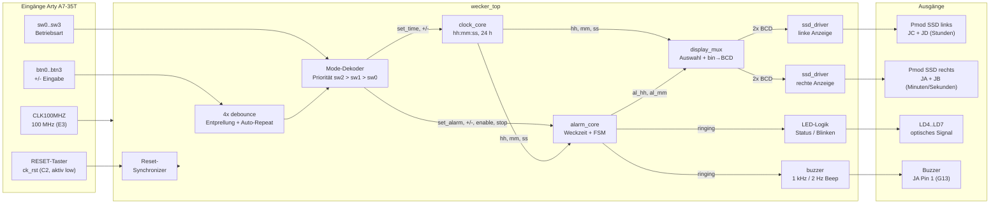
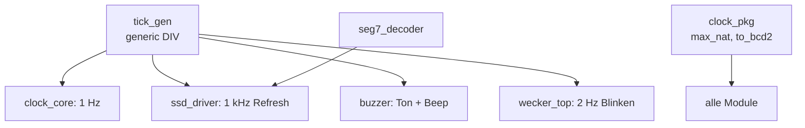
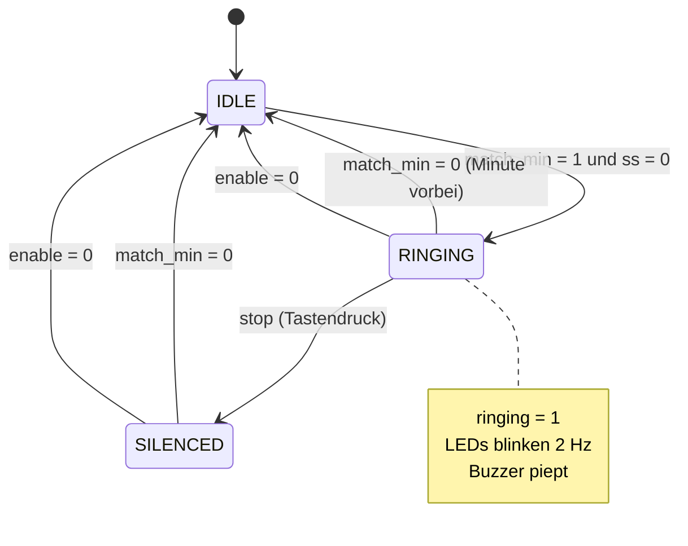
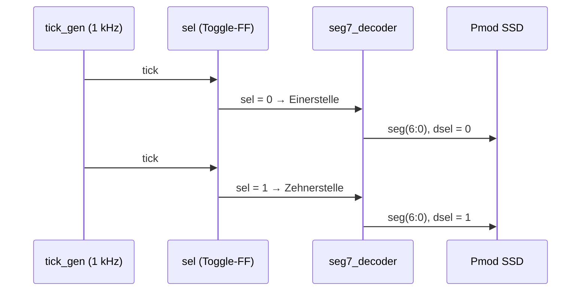

# Blockschaltbild – Digitale Uhr / Wecker

## 1. Gesamt-Architektur (Phase I + II)

## 2. Hilfsmodule (Wiederverwendung)

## 3. Automat `alarm_core`

`match_min = (hh = al_hh) und (mm = al_mm)`

Der Alarm klingelt höchstens eine Minute und schaltet sich dann selbst ab.
Ein Tastendruck während des Klingelns verstellt die Zeit **nicht**, sondern
quittiert nur den Alarm (Zustand `SILENCED`), bis die Weckminute vorbei ist.

## 4. Anzeige-Auswahl (`display_mux`)

| Priorität | Bedingung | linke Anzeige (JC/JD) | rechte Anzeige (JA/JB) |
|---|---|---|---|
| 1 | `sw2 = 1` | Weckzeit Stunden | Weckzeit Minuten |
| 2 | `sw1 = 1` | Stunden | Minuten |
| 3 | `sw0 = 1` | Minuten | Sekunden |
| 4 | sonst | Stunden | Minuten |

## 5. Zeitmultiplex einer Anzeige (`ssd_driver`)

Jede Ziffer wird mit 500 Hz aufgefrischt – deutlich über den vom Datenblatt
geforderten 50 Hz, dadurch flimmerfreie Darstellung (Persistence of Vision).
