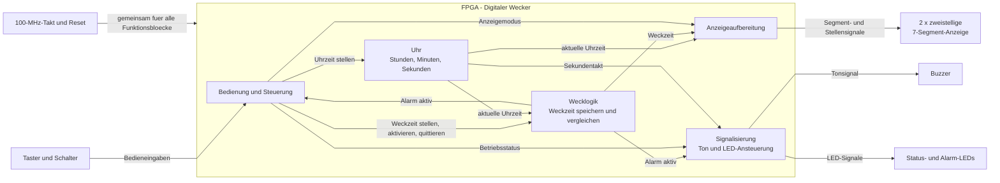

# Blockschaltbild - Wecker (vereinfacht)

Das Blockschaltbild zeigt die wesentlichen Funktionseinheiten des gesamten
Weckers und ihre Signalverbindungen. Mehrere VHDL-Module sind jeweils zu einem
Funktionsblock zusammengefasst.

Eine bearbeitbare Version des Blockschaltbilds ist in
[blockschaltbild_simple.drawio](./blockschaltbild_simple.drawio) verfügbar.

Die Umrandung kennzeichnet die FPGA-Systemgrenze; die aeusseren Bloecke stellen
Ein- und Ausgabeelemente dar. Die Pfeile zeigen den Signalfluss, keinen zeitlichen
Programmablauf. Takt und Reset versorgen alle internen Funktionsbloecke; ihre
einzelnen Verbindungen sind zur besseren Uebersicht zusammengefasst.

Die Anzeige gibt je nach Betriebsart Uhrzeit, Minuten/Sekunden oder Weckzeit aus.
Bei einem Alarm steuert die Signalisierung Buzzer und blinkende LEDs an. Die
Rueckmeldung an die Steuerung sorgt dafuer, dass ein Tastendruck den Alarm
quittiert, ohne dabei die Uhr- oder Weckzeit zu verstellen.